# Docking Molecular: da estrutura à interação

Material didático e prática em servidores web sobre docking molecular: prever onde e como uma molécula pequena se encaixa numa proteína. A aula vai do mais simples ao mais complexo, de receptor e ligante até energia de ligação e dinâmica. A prática compara as poses do DiffDock com dois cristais: o cap do mRNA na eIF4E (1IPC) e um análogo do ensitrelvir na protease principal do SARS-CoV-2 (8HBK). Todos os arquivos de entrada e os resultados de referência estão neste repositório e baixam com um clique.

| Etapa | Ferramenta | Conta | Conteúdo |
|-------|------------|-------|----------|
| Cristais | [RCSB PDB](https://www.rcsb.org/) | não | as estruturas 1IPC e 8HBK, o gabarito da prática |
| Docking | [DiffDock](https://build.nvidia.com/mit/diffdock) (NVIDIA) | sim, gratuita | 20 poses por sistema, com a confiança do modelo |
| Visualização | [Mol*](https://molstar.org/viewer/) | não | as poses sobre o cristal, em 3D |
| Interações | [PLIP](https://plip-tool.biotec.tu-dresden.de/plip-web/plip/index) | não | contatos do cristal e da pose, resíduo por resíduo |

| Autoria | |
|---|---|
| Autor | **Madson A. de Luna-Aragão** |
| Vínculos | Programa Interunidades de Pós-Graduação em Bioinformática, Universidade Federal de Minas Gerais (UFMG), Belo Horizonte, Brasil<br>Centre National de la Recherche Scientifique (CNRS), Institut de Biologie et Chimie des Protéines (IBCP), Lyon, França |
| E-mail | [madsondeluna@gmail.com](mailto:madsondeluna@gmail.com) |
| Site do curso | [madsondeluna.com/curso-docking](https://madsondeluna.com/curso-docking/) |
| Repositório | [madsondeluna/curso-docking](https://github.com/madsondeluna/curso-docking) |
| Curso de dinâmica molecular | [madsondeluna.com/curso-md](https://madsondeluna.com/curso-md/) |


## Roteiro da aula

| Bloco | Conteúdo | Material |
|-------|----------|----------|
| 1 | Receptor e ligante, pose, espaço conformacional, busca e pontuação | seção 1 |
| 2 | Chave e fechadura, encaixe induzido, seleção conformacional | seção 2 |
| 3 | As forças que seguram o ligante | seção 3 |
| 4 | Tipos de sítio; nem toda cavidade é um sítio | seção 4 |
| 5 | Tipos de docking: rígido-rígido, rígido-flexível, flexibilidade parcial, flexível-flexível | seção 5 |
| 6 | Como avaliar uma pose: RMSD e interações | seção 6 |
| 7 | Energia de ligação: ΔG e ΔΔG | seção 7 |
| 8 | Cada programa tem a sua escala | seção 8 |
| 9 | Mutações, resistência e câncer | seção 9 |
| 10 | Níveis de modelagem: do docking à dinâmica, com o DiffDock | seção 10 |
| 11 | De onde vêm receptores e ligantes; formatos de arquivo | seção 11 |
| 12 | Prática: DiffDock contra o cristal | seção Prática |


## 1. O que o docking molecular faz

**Receptor e ligante.** O **receptor** é a macromolécula, quase sempre uma proteína, que tem o sítio de ligação. O **ligante** é a molécula, em geral bem menor, que se encaixa no sítio e sai dele de forma reversível. No docking, o receptor costuma ficar parado e o ligante é a peça que o programa move.

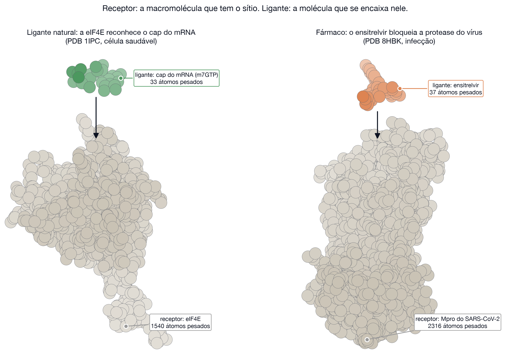

| Caso | Receptor | Ligante |
|------|----------|---------|
| Célula saudável | eIF4E, o fator que inicia a tradução | o cap do mRNA, um ligante natural |
| Infecção | Mpro, a protease do SARS-CoV-2 | o ensitrelvir, um fármaco |

**Onde e em que orientação.** O docking responde a duas perguntas sobre um par receptor e ligante: **onde** a molécula pequena se encaixa e **em que orientação e conformação**. O programa gera milhares de posições candidatas, calcula para cada uma uma nota com uma função de pontuação e devolve as melhores, ordenadas.

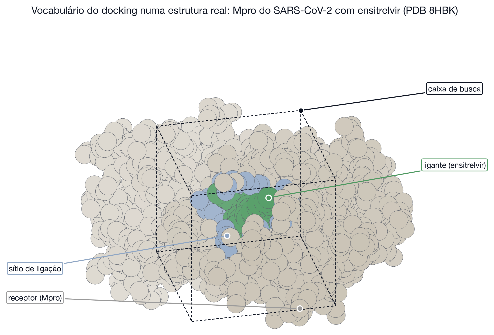

**O que é uma pose.** Pose é uma posição completa do ligante dentro do receptor: **onde** ele está (posição), **para onde aponta** (orientação) e **como suas ligações estão giradas** (conformação). Para o ensitrelvir, cada pose é definida por 12 números: 3 de posição, 3 de orientação e 6 ângulos de torção. O programa devolve uma lista de poses ordenada pela nota; a pose 1 é a de melhor nota, não necessariamente a certa.

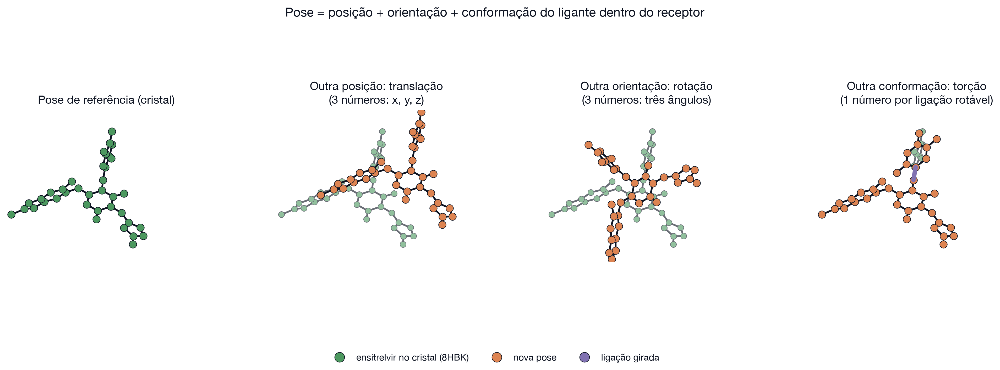

**Espaço conformacional.** É o conjunto de todas as poses possíveis do ligante. Cada ligação rotável acrescenta uma dimensão e multiplica o número de combinações. O cap do mRNA tem 11 torções contra 6 do ensitrelvir: testando só 3 ângulos por ligação, são 243 vezes mais conformações para percorrer.

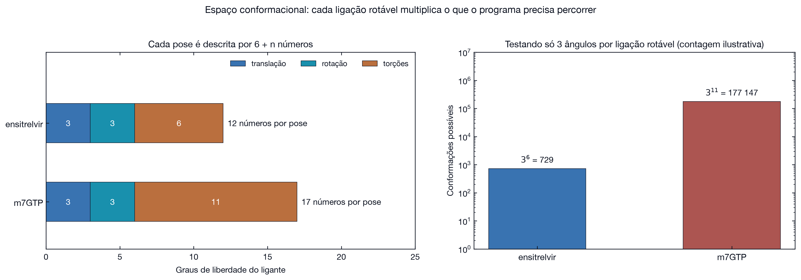

**Analogia: um cadeado de segredo.** Cada disco a mais multiplica por 10 as combinações. Cada ligação rotável faz o mesmo com as conformações do ligante.

**Busca e pontuação.** Todo programa de docking junta duas peças. O **algoritmo de busca** gera poses. A **função de pontuação** dá uma nota a cada pose e ordena a lista. Por isso o docking erra de dois jeitos: no **erro de busca**, a pose certa nunca foi gerada; no **erro de pontuação**, ela foi gerada mas recebeu nota pior que uma errada.

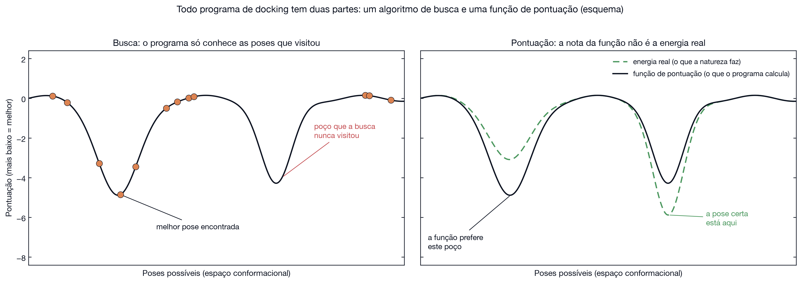

A pergunta que o docking **não** responde bem é quanto a molécula se liga de fato. A função de pontuação acerta a geometria com muito mais frequência do que a afinidade (Kitchen *et al.*, 2004).


## 2. Como o ligante reconhece o receptor

Três modelos explicam o encaixe, em ordem histórica, e todos continuam úteis.

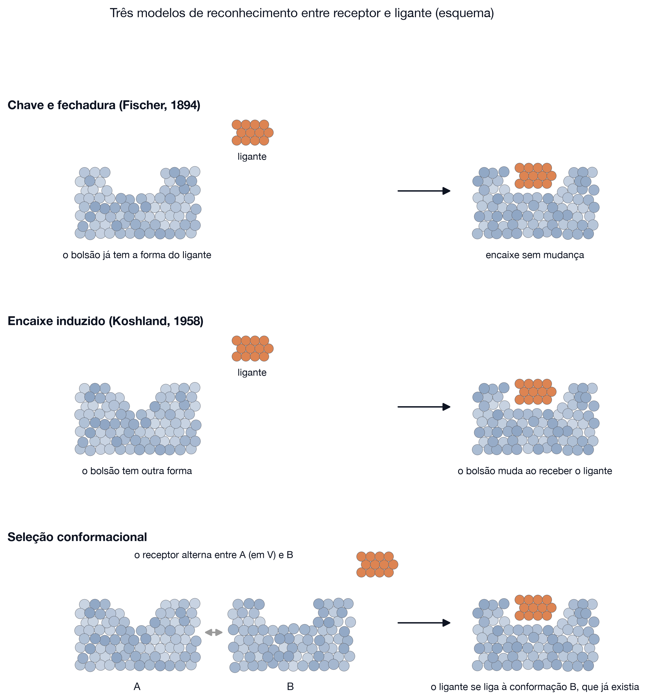

| Modelo | Ideia | Consequência para o docking |
|--------|-------|------------------------------|
| Chave e fechadura (Fischer, 1894) | o bolsão já tem a forma do ligante | basta testar posições e orientações do ligante rígido |
| Encaixe induzido (Koshland, 1958) | o bolsão muda ao receber o ligante | um receptor rígido pode não ter a forma certa |
| Seleção conformacional (Boehr, Nussinov e Wright, 2009) | o receptor oscila entre formas; o ligante escolhe uma | a forma certa pode não ser a do cristal que você baixou |


## 3. As forças que seguram o ligante

A energia de um complexo vem de interações fracas somadas, mais o custo de tirar a água do caminho.

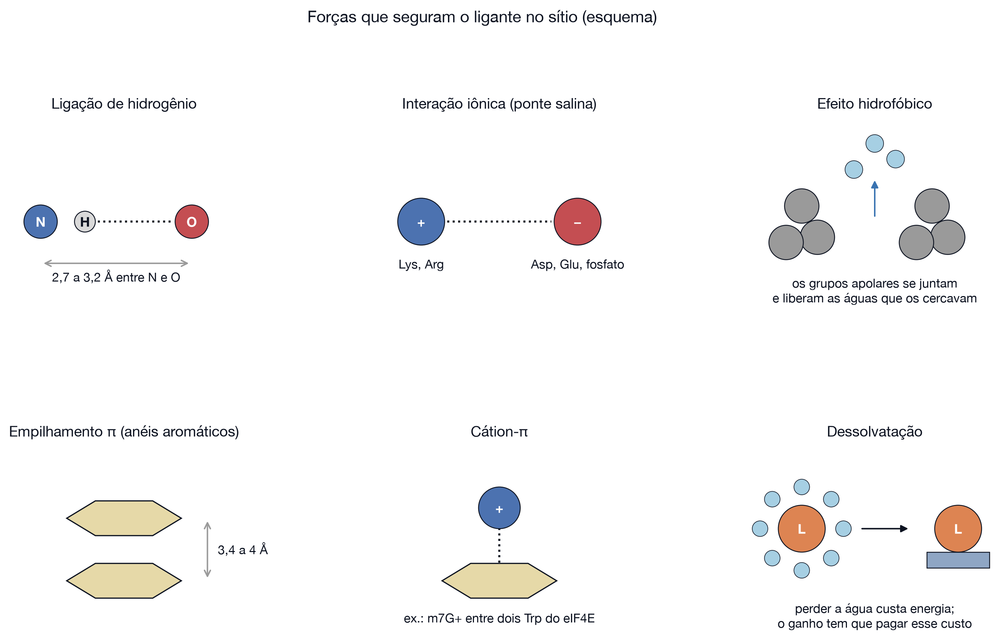

| Força | Alcance típico |
|-------|----------------|
| Ligação de hidrogênio | 2,7 a 3,2 Å entre os átomos pesados |
| Interação iônica (ponte salina) | alguns ångströms, depende do meio |
| Efeito hidrofóbico | contato entre superfícies apolares |
| Empilhamento π | 3,4 a 4 Å entre anéis |
| Cátion-π | anel aromático e carga positiva |
| Dessolvatação | custo de remover a água |

**Analogia: velcro.** Nenhum gancho segura sozinho; o conjunto segura. Tirar um gancho enfraquece pouco, tirar metade solta tudo.


## 4. Onde o ligante se encaixa: tipos de sítio

Uma cavidade é um buraco na superfície da proteína. Um sítio de ligação é uma cavidade onde algo se liga de fato. **Toda proteína tem muito mais cavidades do que sítios.**

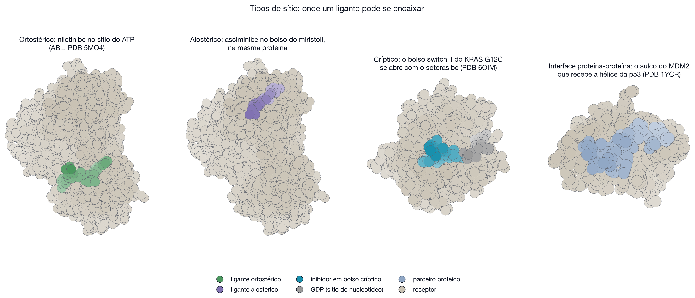

| Tipo de sítio | O que é | Exemplo verificado nesta aula |
|---------------|---------|-------------------------------|
| Ortostérico | onde o substrato ou ligante natural se liga | sítio do ATP da quinase ABL, com nilotinibe (PDB 5MO4) |
| Alostérico | outro lugar da mesma proteína; ligar ali muda a atividade do sítio ortostérico | bolso do miristoil da ABL, com asciminibe (mesma estrutura) |
| Críptico | só se abre quando o ligante chega; não aparece, ou aparece raso, na estrutura livre | bolso switch II do KRAS G12C, com sotorasibe (PDB 6OIM) |
| Interface proteína-proteína | superfície larga e rasa que recebe outra proteína | sulco do MDM2 que recebe a hélice da p53 (PDB 1YCR) |

**Nem toda cavidade é um sítio.** O P2Rank, pelo PrankWeb, devolve as cavidades de uma estrutura ordenadas por um escore. Na Mpro são oito cavidades e só a primeira é o sítio ativo. As outras sete ficam de 8 a 26 Å do ensitrelvir: são reentrâncias da superfície sem ligante conhecido.

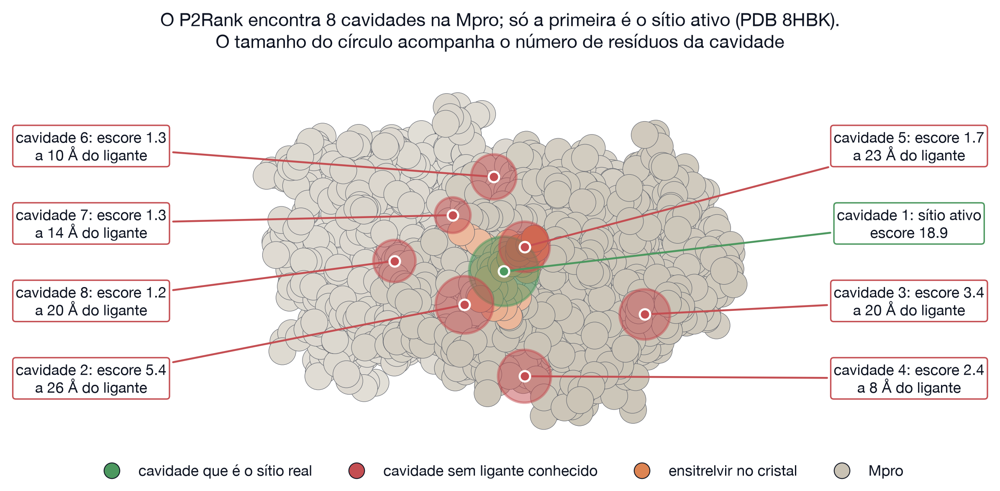

**Cuidados ao olhar uma cavidade.**

- Buracos onde ficam glicerol, PEG, sulfato ou tampão no cristal costumam ser artefatos da cristalização, não sítios.
- Cavidades em interfaces entre cópias da proteína no cristal podem não existir na célula.
- Uma interface proteína-proteína raramente é uma cavidade funda, e por isso escapa de quem só procura bolsões.
- Um escore alto diz que a cavidade **parece** um sítio, não que algum ligante se ligue ali.


## 5. Tipos de docking

**Pela flexibilidade, do mais simples ao mais completo.**

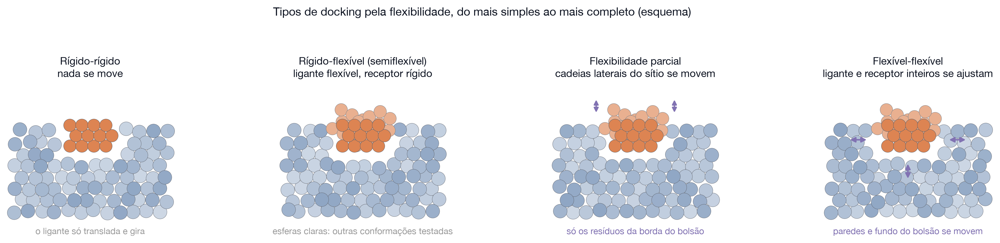

| Tipo | O que se move | O que ganha em fidelidade | Custo | Exemplos |
|------|---------------|---------------------------|-------|----------|
| Rígido-rígido | nada; só posição e orientação | encaixe de forma | muito baixo | triagem por forma, ZDOCK |
| Rígido-flexível (semiflexível) | torções do ligante | conformação do ligante | baixo | AutoDock, DockThor, DiffDock |
| Flexibilidade parcial | ligante e cadeias laterais escolhidas | ajuste local do bolsão | médio | AutoDock com resíduos flexíveis, GOLD |
| Flexível-flexível | ligante e receptor inteiros | encaixe induzido, alças que fecham | alto | Rosetta, HADDOCK, dinâmica |

Na literatura, "semiflexível" quase sempre quer dizer o segundo tipo: ligante flexível, receptor rígido.

**Quanto cada tipo pesa no cálculo.** Cada parte que se move acrescenta números que o programa ajusta em cada pose. Contados na Mpro com o ensitrelvir (PDB 8HBK): 6 no rígido-rígido, 12 com o ligante flexível, 31 liberando 8 resíduos do bolsão e cerca de 1 100 com a proteína inteira. Mais graus de liberdade deixam o modelo mais perto do que acontece em solução e custam mais tempo.

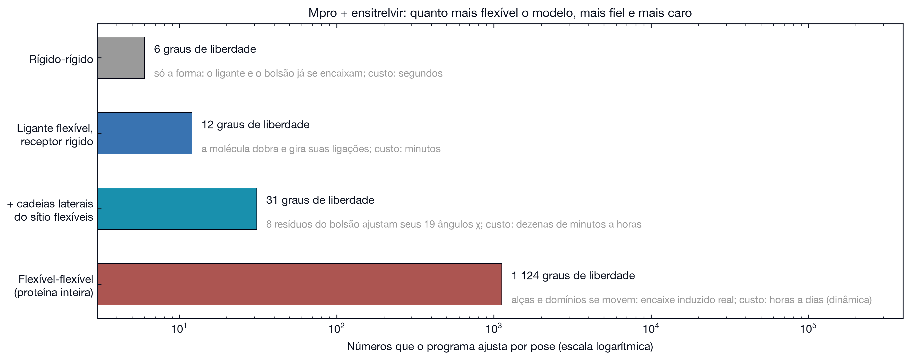

**Quando o receptor rígido falha: o imatinibe na quinase ABL.** A alça de ativação da ABL alterna entre uma forma ativa e uma inativa. O imatinibe só se encaixa na forma inativa (Schindler *et al.*, 2000): docado numa estrutura rígida da forma ativa, ele não cabe.

**Pelo que se sabe do sítio.**

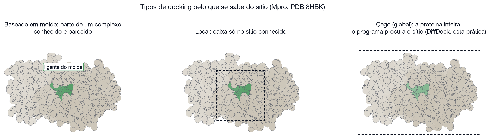

| Tipo | Quando usar | Risco |
|------|-------------|-------|
| Baseado em molde | existe complexo parecido resolvido | depende de o molde ser mesmo parecido |
| Local | o sítio é conhecido | se a caixa estiver errada, a resposta está errada |
| Cego (global) | o sítio é desconhecido; é o modo do DiffDock | muitas cavidades candidatas, mais falsos positivos |

**Pelos parceiros.** Proteína e molécula pequena é o caso desta prática. Proteína e peptídeo e proteína e proteína pedem outros programas, porque a superfície de contato é larga e rasa.

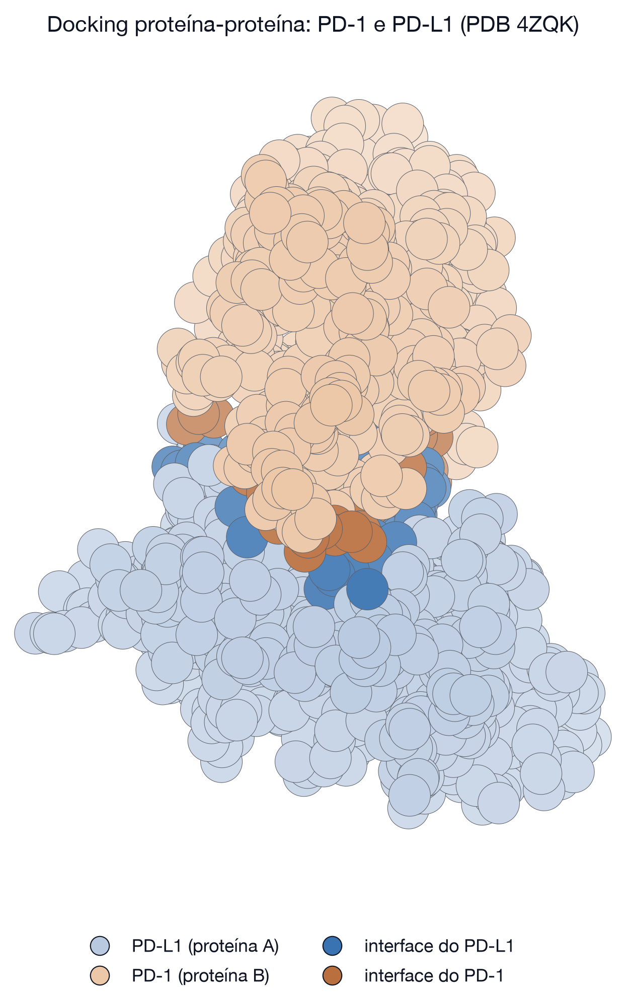

**PD-1 e PD-L1.** O PD-1, na superfície do linfócito T, liga-se ao PD-L1 e freia a resposta imune. Na célula saudável, esse freio evita que o sistema imune ataque o próprio corpo. Muitos tumores expõem PD-L1 e usam o freio para escapar (Zak *et al.*, 2015). Os anticorpos de imunoterapia, como o pembrolizumabe (anti-PD-1) e o atezolizumabe (anti-PD-L1), ocupam essa interface e soltam o freio. Para esse tipo de problema existem servidores próprios, como o [ClusPro](https://cluspro.bu.edu/), que também tem modo para peptídeos (Kozakov *et al.*, 2017; Porter *et al.*, 2017).


## 6. Como avaliar uma pose: RMSD e interações

**Como o RMSD é calculado.** Para cada átomo pesado, mede-se a distância entre a posição na pose e a posição no cristal; o RMSD é a raiz da média dos quadrados dessas distâncias. O limiar de 2 Å é convenção da área: abaixo dele, a pose reproduz os mesmos contatos. Sem uma pose experimental de referência não há RMSD.

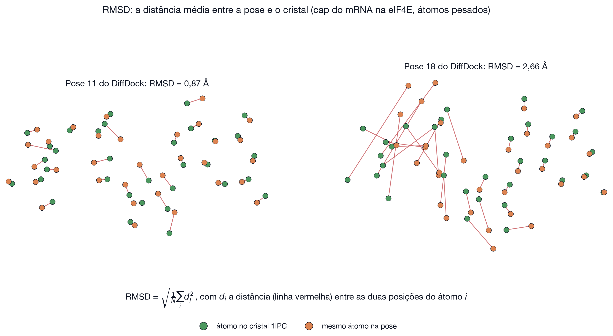

| RMSD | Leitura |
|------|---------|
| abaixo de 2 Å | pose correta, repete os mesmos contatos |
| 2 a 3 Å | orientação geral certa, detalhes errados |
| acima de 3 Å | pose errada |

**Interações.** O PLIP lista as interações de um complexo por resíduo e por tipo (Adasme *et al.*, 2021). Comparando a pose com o cristal, dá para ver não só quantas interações se repetem, mas quais. O RMSD trata todos os átomos por igual; a lista de interações diz **quais** contatos a pose acerta, e é disso que depende a atividade de um fármaco.

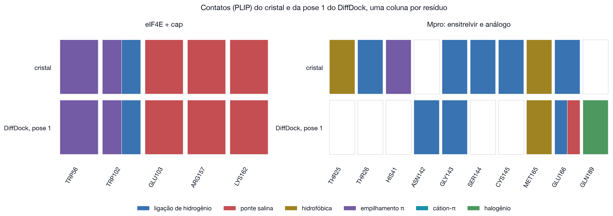


## 7. Energia de ligação: ΔG e ΔΔG

**O que é ΔG de ligação.** É a diferença de energia livre entre o complexo e as duas moléculas separadas:

$$\Delta G_{lig} = G_{complexo} - (G_{receptor} + G_{ligante})$$

ΔG negativo quer dizer que a ligação acontece espontaneamente; quanto mais negativo, mais estável o complexo.

**Analogia: o poço.** Receptor e ligante separados ficam no nível de referência. Ao se ligarem, o sistema desce para um poço, e o ΔG é a profundidade dele. Num poço fundo o ligante precisa de muita energia para sair e passa mais tempo ligado; num poço raso ele sai com facilidade.

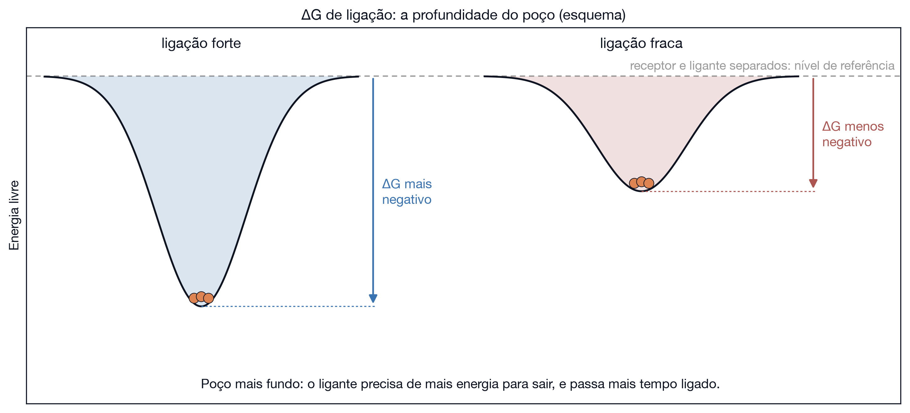

**O que uma função de pontuação calcula.** Uma função empírica soma termos de contato estérico, ligação de hidrogênio e contato hidrofóbico, com pesos ajustados para reproduzir afinidades medidas. O resultado é uma estimativa grosseira do ΔG: o erro típico dessas funções passa de 2 kcal/mol (Trott e Olson, 2010), e duas poses separadas por menos que isso não podem ser ordenadas com segurança.

**ΔΔG.** É a diferença entre dois ΔG. Comparando uma proteína mutante com a selvagem, para o mesmo ligante:

$$\Delta\Delta G = \Delta G_{mutante} - \Delta G_{selvagem}$$

| ΔΔG | Significado | Leitura |
|-----|-------------|---------|
| positivo | a mutação deixa o poço mais raso | ligação mais fraca |
| perto de zero | a mutação não altera a ligação | sem efeito |
| negativo | a mutação aprofunda o poço | ligação mais forte |

A mesma conta compara dois ligantes no mesmo receptor, ΔG(ligante B) − ΔG(ligante A), e é a base para decidir qual análogo sintetizar. Um ΔΔG só tem significado quando é maior que o erro da função de pontuação.

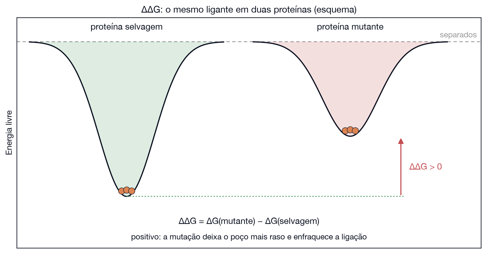

**Exemplo saudável: hot spots de interfaces.** Trocando resíduos por alanina, um a um, e medindo o ΔΔG de cada troca em 2 325 mutantes, Bogan e Thorn (1998) mostraram que a energia de uma interface proteína-proteína se concentra em poucos resíduos, os hot spots, ricos em triptofano, tirosina e arginina.

**Exemplo patológico: resistência.** A mutação T315I da ABL é um ΔΔG positivo para o imatinibe: o fármaco perde a ligação de hidrogênio com a Thr315 e esbarra na isoleucina, enquanto a enzima continua ligando o ATP (seção 9).


## 8. Cada programa tem a sua escala

Cada função soma termos diferentes, com pesos diferentes, ajustados a conjuntos de treino diferentes. Por isso os números de dois programas não se comparam.

| Programa | Tipo de função | O que soma | Unidade e sinal |
|----------|----------------|------------|-----------------|
| AutoDock Vina | empírica | contato estérico, ligação de hidrogênio, contato hidrofóbico e penalidade por torção, com pesos ajustados a afinidades medidas | kcal/mol estimada; mais negativo é melhor |
| AutoDock 4 | campo de força semiempírico | van der Waals, ligação de hidrogênio, eletrostática, dessolvatação e perda de torção | kcal/mol estimada; mais negativo é melhor |
| Glide | empírica (GlideScore) | termos do tipo ChemScore com penalidades próprias | kcal/mol aproximada; mais negativo é melhor |
| GOLD | fitness (ChemPLP) | contatos por tipo de átomo, ligação de hidrogênio e torção | sem unidade; **mais positivo é melhor** |
| DiffDock | aprendizado de máquina | nenhum termo físico: um modelo treinado no PDB dá um escore à chance de a pose estar a menos de 2 Å da certa | confiança (logit), sem unidade; maior é melhor |

Referências: Trott e Olson, 2010; Morris *et al.*, 1998; Friesner *et al.*, 2004; Korb *et al.*, 2009; Corso *et al.*, 2023.

**Analogia: notas de provas diferentes.** Um 8 numa prova valendo 10 e um 80 noutra valendo 100 não dizem quem sabe mais. Do mesmo modo, uma energia em kcal/mol de um programa e a confiança do DiffDock não dizem qual pose é melhor. Compare apenas números do mesmo programa, na mesma versão e com os mesmos parâmetros, e compare programas diferentes pelo que se mede contra o cristal: RMSD e contatos.

**Três números para julgar uma pose, e o que conta como bom e como ruim.** Com as poses do DiffDock nos dois sistemas da prática.

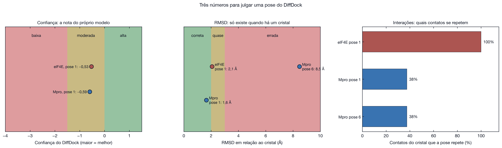

| Métrica | O que mede | Bom | Ruim | Armadilha |
|---------|-----------|-----|------|-----------|
| Confiança do DiffDock | nota do modelo para a pose | acima de 0 | abaixo de −1,5 | não é energia nem probabilidade; não se compara com outro programa |
| RMSD (Å) | distância média entre a pose e uma referência | abaixo de 2 | acima de 3 | só existe quando há pose de referência |
| Interações recuperadas | contatos do cristal que a pose repete | acima de 70% | abaixo de 30% | contar contato sem olhar quais contatos engana |


## 9. Mutações, resistência e câncer

Uma troca de um único resíduo no sítio muda o encaixe e pode anular um fármaco.

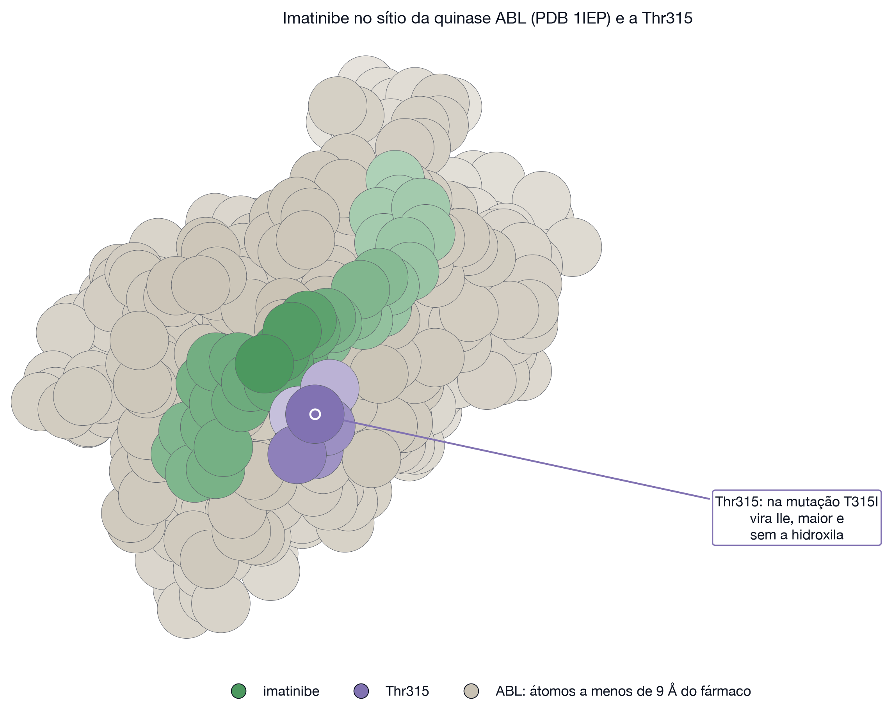

**Leucemia mieloide crônica.** O imatinibe se liga ao sítio do ATP da quinase BCR-ABL. A troca da treonina 315 por isoleucina, T315I, remove uma hidroxila que fazia ligação de hidrogênio com o fármaco e põe uma cadeia lateral maior no caminho. Pacientes com essa mutação deixam de responder (Gorre *et al.*, 2001; Shah *et al.*, 2002). A saída veio em duas frentes: o ponatinibe, desenhado para contornar o volume extra (O'Hare *et al.*, 2009), e o asciminibe, que vai para o sítio alostérico.

**Proteína-proteína e fármaco no mesmo sítio.** O MDM2 segura a p53 por um sulco que recebe três resíduos da hélice: Phe19, Trp23 e Leu26 (Kussie *et al.*, 1996). As nutlinas ocupam esse mesmo sulco e soltam a p53, reativando a resposta ao dano no DNA (Vassilev *et al.*, 2004). Um sítio que existe para receber uma proteína pode receber um fármaco.

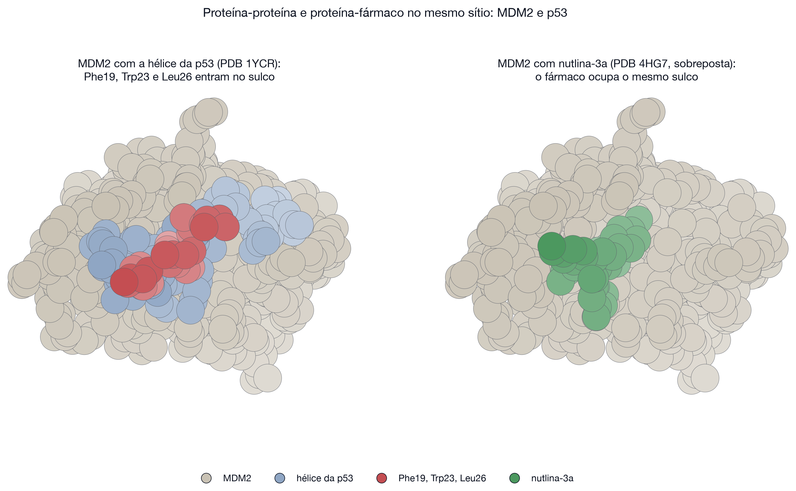

**O que o docking consegue dizer sobre uma mutação.** Com cuidado: comparar a pose e a energia no selvagem e no mutante dá uma indicação, mas o receptor rígido não reproduz o rearranjo que costuma acompanhar a mutação. Para isso, a seção 10.


## 10. Níveis de modelagem: do docking à dinâmica

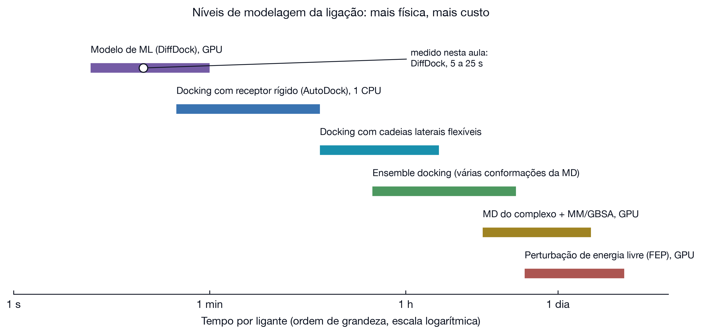

| Nível | O que modela | O que você ganha | Ordem de grandeza por ligante |
|-------|--------------|------------------|-------------------------------|
| Modelo de aprendizado de máquina | aprende poses a partir do PDB | velocidade | segundos em GPU; 5 a 25 s medidos nesta aula |
| Docking com receptor rígido | forma e interações, ligante flexível | pose, ranking grosseiro | minutos em CPU |
| Docking com cadeias laterais flexíveis | parte do encaixe induzido | sítios que precisam abrir | dezenas de minutos |
| Ensemble docking | várias conformações do receptor, vindas da dinâmica | receptor que se move | horas (Amaro *et al.*, 2018) |
| Dinâmica molecular com MM/GBSA | o complexo em água, com movimento | estabilidade da pose e energia melhor | horas a dias (Genheden e Ryde, 2015) |
| Perturbação de energia livre (FEP) | diferença de energia livre entre dois ligantes | a melhor previsão de afinidade disponível | dias em GPU (Wang *et al.*, 2015) |

**Como escolher o nível.** Use o mais barato que responda à sua pergunta. Para escolher 50 compostos entre um milhão, docking rígido basta. Para decidir qual de dois análogos sintetizar, docking não basta.

**Docking por aprendizado de máquina: o DiffDock.** O DiffDock não soma termos de energia. É um modelo de difusão treinado com complexos do PDB: parte de poses aleatórias e, passo a passo, ajusta posição, orientação e torções do ligante, os mesmos 6 + n graus de liberdade da seção 1 (Corso *et al.*, 2023). Um segundo modelo dá a cada pose uma **confiança**: um escore (logit) da chance de a pose estar a menos de 2 Å da certa. Não é probabilidade nem energia, e não tem unidade. A versão servida pela NVIDIA é o DiffDock 2.3, treinado com complexos do PDB reunidos nos conjuntos PLINDER e SAIR.

| O que o DiffDock faz | Consequência |
|----------------------|--------------|
| procura na proteína inteira | não precisa de caixa de busca (docking cego) |
| mantém o receptor rígido | o mesmo limite do docking clássico (seção 5) |
| roda em segundos numa GPU | cabe numa aula; na NVIDIA exige conta gratuita |
| aprendeu com complexos do PDB (PLINDER e SAIR, na versão 2.3 da NVIDIA) | pode reconhecer complexos que já viu; o acerto num caso conhecido não garante o acerto numa molécula nova |

**Antes e depois do docking.**

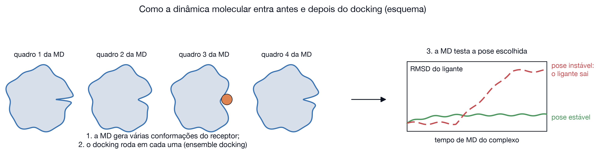

| Momento | O que a dinâmica faz | Por quê |
|---------|---------------------|---------|
| Antes | gera várias conformações do receptor para rodar o docking em cada uma | o receptor rígido é a maior limitação do método (Lin *et al.*, 2002; Amaro *et al.*, 2018) |
| Antes | revela bolsos crípticos que não aparecem no cristal | foi assim que se encontraram mais de 50 bolsos nas proteínas do SARS-CoV-2 (Zimmerman *et al.*, 2021) |
| Depois | testa se a pose se mantém em água, a 310 K | uma pose boa no escore pode se desfazer em poucos nanossegundos |
| Depois | estima a energia com MM/GBSA ou FEP | funções de pontuação de docking são rápidas, não exatas |

**Como testar a estabilidade de uma pose.** Simule o complexo e acompanhe o RMSD do ligante ao longo do tempo. Se ele oscila numa faixa estreita, a pose é estável. Se cresce e o ligante sai do sítio, o docking entregou uma pose plausível na geometria e errada na física. O curso de dinâmica molecular cobre essa parte: [madsondeluna.com/curso-md](https://madsondeluna.com/curso-md/).


## 11. De onde vêm receptores e ligantes

**Receptores.** O Protein Data Bank guarda estruturas resolvidas por cristalografia de raios X, ressonância magnética nuclear e crio-microscopia eletrônica. Toda estrutura tem limitações que afetam o docking:

| O que olhar na estrutura | Por que importa |
|--------------------------|-----------------|
| Resolução | abaixo de 2,5 Å as cadeias laterais do sítio são confiáveis |
| Ligante presente | uma estrutura com ligante parecido já tem o sítio aberto |
| Resíduos faltando | alças não resolvidas podem fazer parte do sítio |
| Hidrogênios | quase nunca estão no cristal; o programa os adiciona |
| Moléculas do tampão | glicerol, PEG e sulfato ocupam cavidades sem serem ligantes |

Modelos previstos, como os do AlphaFold (Jumper *et al.*, 2021) e do OpenFold, ampliaram a oferta de receptores, mas a conformação prevista pode não ser a que recebe o ligante (seção 2, seleção conformacional). O sistema B da prática usa uma Mpro predita pelo OpenFold.

**Ligantes.** PDB, PubChem (Kim *et al.*, 2022), ChEMBL e DrugBank fornecem estruturas e identificadores. A forma mais portátil de escrever uma molécula pequena é a SMILES, uma linha de texto (Weininger, 1988).

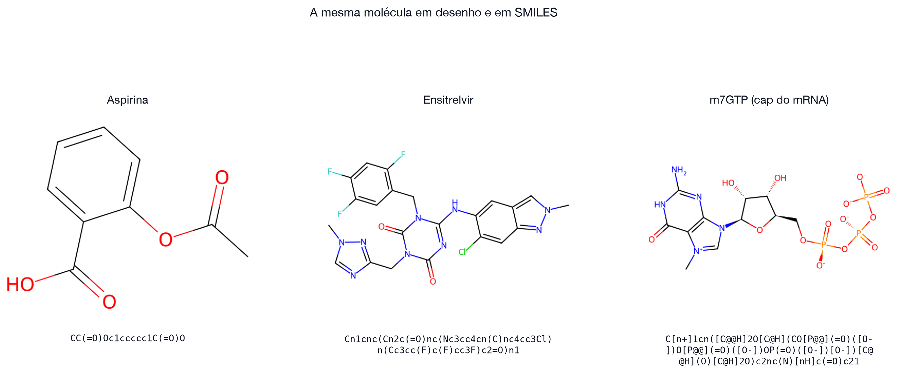

**Formatos de arquivo: o que cada um carrega.** Todos descrevem átomos; mudam no que guardam junto. A escolha do formato decide se o programa recebe coordenadas 3D, hidrogênios e cargas, ou se precisa gerá-los.

| Formato | O que carrega | Coordenadas 3D | Hidrogênios e carga | Nesta prática |
|---------|---------------|----------------|---------------------|---------------|
| PDB (`.pdb`) | uma linha por átomo: nome, resíduo, cadeia, x, y, z, ocupação e fator B | sim | hidrogênios quase nunca; sem carga parcial | `receptor.pdb`, `receptor_openfold.pdb` |
| SDF (`.sdf`) | molécula pequena: tabela de átomos com x, y, z e tabela de ligações com a ordem de cada uma | sim | carga formal na linha `M  CHG`; hidrogênios se o arquivo trouxer | ligantes e poses do DiffDock |
| Mol2 (`.mol2`) | átomos com tipo químico (`C.3`, `N.ar`) e carga parcial de cada um, mais as ligações | sim | sim, os dois | `ligante_3d.mol2` (alternativa) |
| PDBQT (`.pdbqt`) | PDB com carga parcial (Q) e tipo de átomo do AutoDock (T), mais as ligações que giram | sim | só hidrogênios polares; carga parcial | formato do AutoDock; não usado aqui |
| SMILES (`.smi`) | uma linha de texto: átomos, ligações, anéis, cargas e quiralidade | não | carga formal entre colchetes | `ligante.smi` (alternativa) |

**Por dentro de um PDB.** Uma linha do Trp56 em `receptor.pdb`: número do átomo, nome do átomo, resíduo, cadeia, número do resíduo, x, y, z (Å), ocupação, fator B e elemento. O fator B (26,70) mede quanto o átomo vibra ou varia no cristal: quanto maior, menos certa a posição.

```
ATOM    258  CA  TRP A  56      60.302 111.176 -11.513  1.00 26.70           C
```

**Por dentro de um SDF.** O começo de `ligante_cristal.sdf`: nome, programa que gerou, linha de contagem (33 átomos, 35 ligações) e a primeira linha da tabela de átomos. Depois da tabela de átomos vem a de ligações (átomo 1, átomo 2, ordem). Por isso o SDF guarda a química da molécula, e o PDB, sem essa tabela, deixa as ligações para o programa adivinhar pela distância.

```
MGP
  ModelServer 0.9.13

 33 35  0  0  1  0  0  0  0  0  0
   52.8360  113.4570   -5.7970 P   0  0  0 ...
```

**Por dentro de um Mol2.** Primeiro átomo de `ligante_3d.mol2`: índice, nome, x, y, z, tipo químico (`C.3` é carbono sp3), número e nome do fragmento e a carga parcial (+0,1427). As cargas parciais somam −2,98, perto da carga total −3.

```
      1 C           0.3084   -2.7213   -2.8552 C.3     1  UNL1        0.1427
```

**SDF com várias moléculas.** As 20 poses do DiffDock vêm num SDF só: cada bloco é uma pose, termina em `$$$$` e traz no título a confiança.

```
pose_1 confianca -0.528
     RDKit          3D

 33 35  0  0  0  0  0  0  0  0999 V2000
   52.6286  ...
$$$$
pose_2 confianca -0.712
```

**Por dentro de uma SMILES.** O cap em `ligante.smi`: `[n+]` é o nitrogênio com carga positiva, `[O-]` cada oxigênio negativo dos fosfatos, `@` e `@@` a quiralidade dos carbonos do açúcar. Não há coordenadas: o programa gera o 3D.

```
C[n+]1cn([C@@H]2O[C@H](CO[P@@](=O)([O-])O[P@@](=O)([O-])OP(=O)([O-])[O-])[C@@H](O)[C@H]2O)c2nc(N)[nH]c(=O)c21
```

**Como obter a SMILES de um ligante.**

1. No RCSB PDB: abra a página do ligante, por exemplo [o ligante MGP](https://www.rcsb.org/ligand/MGP), e copie a linha SMILES isomérica.
2. No PubChem: busque pelo nome do composto e copie a SMILES canônica ou isomérica.
3. A partir de um arquivo que você já tem: o Open Babel converte SDF, MOL2 ou PDB em SMILES, e também SDF em Mol2.

**Protonação importa.** A mesma molécula tem cargas diferentes em pH diferente. O cap m7GTP, em pH 7,4, fica com carga total −3, por causa dos três fosfatos. Os arquivos de `dados/` já estão nesse estado.


## Prática: DiffDock contra o cristal

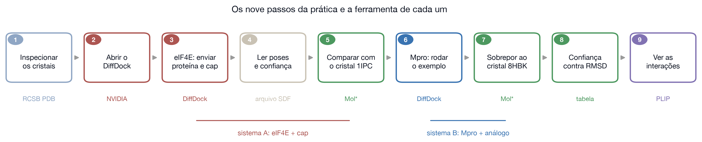

| Sistema | Pergunta | Passos | Ferramentas |
|---------|----------|--------|-------------|
| A: eIF4E + cap | o DiffDock reproduz o cap do cristal 1IPC? | 1 a 5 | RCSB PDB, DiffDock, Mol* |
| B: Mpro + análogo | numa proteína predita e com uma molécula nova, ele chega perto do fármaco do cristal 8HBK? | 6 e 7 | DiffDock, Mol* |
| A e B | a confiança do modelo acompanha o acerto? quais contatos se repetem? | 8 e 9 | tabela, PLIP |

O DiffDock da NVIDIA pede uma conta gratuita. Em aula, o professor roda ao vivo e os alunos usam os resultados de referência deste repositório. Os outros serviços são livres e não pedem cadastro.

### Por que estes dois sistemas e o DiffDock

| | Sistema A: eIF4E + cap | Sistema B: Mpro + análogo do ensitrelvir |
|---|---|---|
| Receptor | cristal 1IPC, sem o cap (redocking) | modelo predito pelo OpenFold, sem ligante |
| Ligante | ligante natural: m7GTP, carga −3, 11 torções | molécula nova: análogo de um fármaco aprovado |
| Referência | o próprio cap no cristal 1IPC | o ensitrelvir no cristal 8HBK, no núcleo comum |
| Biologia | tradução do mRNA; eIF4E em excesso no câncer | replicação do SARS-CoV-2; antiviral oral |
| O que testa | o caso mais fácil: tudo vem do mesmo cristal | o caso real do desenho de fármacos |

O DiffDock não pede caixa de busca, roda em segundos e representa a geração de docking por aprendizado de máquina (seção 10). O sistema B é o exemplo que já vem pronto na página do DiffDock: dá para rodar sem enviar arquivo nenhum. Os dois sistemas têm cristal, e é o cristal que diz se o modelo acertou.

### Sistema A: o cap do mRNA e a eIF4E

Todo mRNA de eucarioto começa com um **cap 5'**: uma guanina metilada no nitrogênio 7 (m7G), presa ao primeiro nucleotídeo por uma ponte de três fosfatos. O ligante da prática, o m7GTP, é essa ponta isolada. A **eIF4E** reconhece o cap e, com a eIF4G e a eIF4A, forma o complexo eIF4F, que traz o ribossomo até o mRNA. É o passo que limita a velocidade da tradução (Sonenberg e Hinnebusch, 2009).

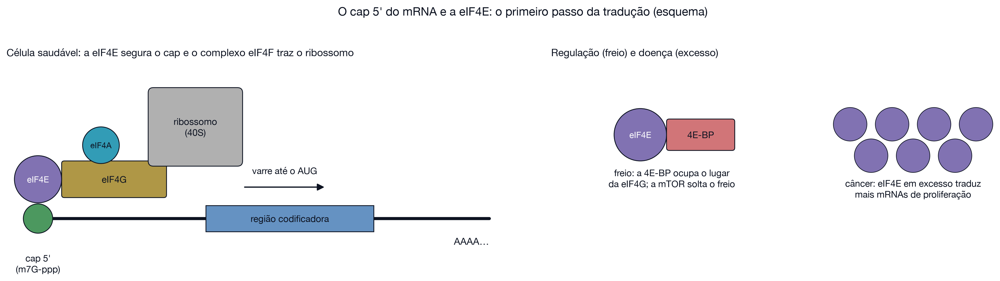

| Situação | O que acontece com a eIF4E | Consequência |
|----------|----------------------------|--------------|
| Célula em repouso | a 4E-BP ocupa o lugar da eIF4G e segura a eIF4E | pouca tradução dependente do cap |
| Nutrientes e fatores de crescimento | a mTOR fosforila a 4E-BP e solta a eIF4E (Gingras *et al.*, 1999) | a tradução acelera |
| Câncer | eIF4E em excesso ou sempre livre | mais tradução de mRNAs de proliferação, como ciclina D1 e c-Myc |
| Tratamento em estudo | a ribavirina imita o cap e compete pelo sítio | testada em leucemia mieloide aguda (Assouline *et al.*, 2009) |

No cristal 1IPC (Tomoo *et al.*, 2002), o anel da guanina metilada fica **entre Trp56 e Trp102**, como o recheio de um sanduíche, e os três fosfatos apontam para Arg157 e Lys162. O anel tem carga positiva e os anéis dos triptofanos atraem cargas positivas pela nuvem de elétrons π: é a interação **cátion-π** (Ma e Dougherty, 1997). O cap tem carga −3, 11 ligações rotáveis e depende dessa interação: é o tipo de ligante em que funções de pontuação clássicas erram.

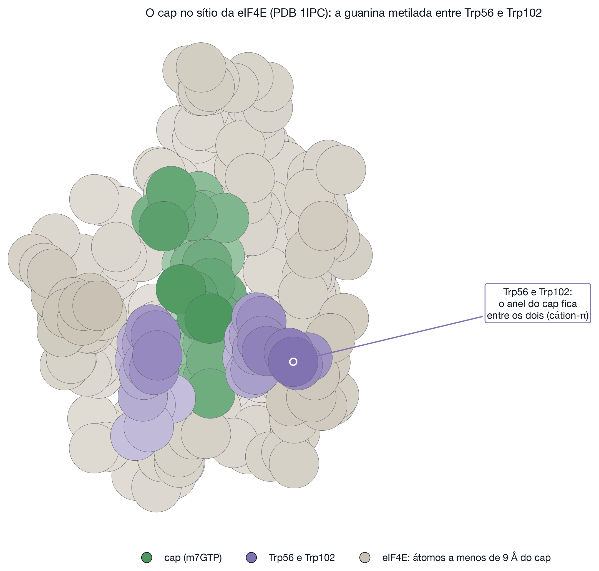

### Sistema B: a Mpro e um análogo do ensitrelvir

A **Mpro** corta a poliproteína do SARS-CoV-2 em pontos específicos; sem ela, o vírus não se replica. O **ensitrelvir** é um inibidor oral, não covalente, aprovado no Japão (Unoh *et al.*, 2022), e está no cristal 8HBK. O exemplo da NVIDIA traz um **análogo** do ensitrelvir e a Mpro **predita pelo OpenFold**, sem ligante. É a situação real do desenho de fármacos: uma molécula que nunca foi cristalizada, num receptor que veio de um modelo.

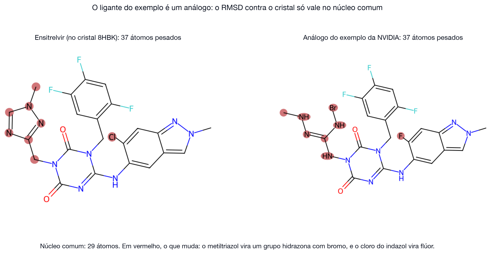

### Antes de começar

Sistema A: baixe [dados/eif4e.zip](dados/eif4e.zip) e descompacte, ou baixe cada arquivo pelo link. Sistema B: os arquivos já vêm no exemplo da página do DiffDock; as cópias em `dados/mpro_analogo/` foram baixadas dos arquivos de exemplo da NVIDIA (assets.ngc.nvidia.com, exemplo do DiffDock).

| Arquivo | O que é | Passo |
|---------|---------|-------|
| [receptor.pdb](dados/eif4e/receptor.pdb) | A: cadeia A da 1IPC, 1 540 átomos pesados, sem água, sem íons e sem o cap | 3 |
| [ligante_3d.sdf](dados/eif4e/ligante_3d.sdf) | A: o cap (m7GTP) em 3D, com hidrogênios e carga −3 | 3 |
| [ligante_3d.mol2](dados/eif4e/ligante_3d.mol2) | A: o mesmo cap em Mol2 | alternativa ao passo 3 |
| [ligante.smi](dados/eif4e/ligante.smi) | A: o cap em SMILES, pH 7,4 | alternativa ao passo 3 |
| [ligante_cristal.sdf](dados/eif4e/ligante_cristal.sdf) | A: o cap na posição do cristal, o gabarito | 5 |
| [receptor_openfold.pdb](dados/mpro_analogo/receptor_openfold.pdb) | B: a Mpro predita pelo OpenFold (`mpro_chain_OpenFold_processed_ms.pdb` no exemplo) | 6 |
| [ligante_analogo_3d.sdf](dados/mpro_analogo/ligante_analogo_3d.sdf) | B: o análogo do ensitrelvir (`Ensitrelvir_analog_3d.sdf` no exemplo) | 6 |
| [ligante_cristal.sdf (8HBK)](dados/mpro/ligante_cristal.sdf) | B: o ensitrelvir no cristal, a referência | 7 |

### Passo 1: inspecionar os dois cristais

**1.1.** Abra [rcsb.org/structure/1IPC](https://www.rcsb.org/structure/1IPC). Na caixa **Experimental Data Snapshot**, confira o método (X-RAY DIFFRACTION) e a resolução (2,0 Å). Em **Small Molecules**, ache o ligante **MGP**: é o cap.

**1.2.** Clique em **3D View** e clique sobre o ligante: o Mol* aproxima o sítio e mostra em bastões os resíduos ao redor. Passe o mouse sobre os dois anéis que prensam o cap; o nome aparece no canto inferior direito (TRP 56 e TRP 102).

**1.3.** Abra [rcsb.org/structure/8HBK](https://www.rcsb.org/structure/8HBK) e repita: o ligante **7YY** é o ensitrelvir, numa fenda entre dois domínios, onde ficam His41 e Cys145, a díade catalítica.

**Por quê.** O DiffDock não sabe onde fica o sítio e devolve poses em qualquer caso. Ver os dois ligantes no cristal agora dá o gabarito contra o qual cada pose será julgada.

### Passo 2: abrir o DiffDock

**2.1.** Abra [build.nvidia.com/mit/diffdock](https://build.nvidia.com/mit/diffdock) e entre com a conta da NVIDIA (gratuita).

**2.2.** No painel da esquerda ficam os campos **Molecule** (o ligante) e **Target Protein** (o receptor), um menu de exemplos e os parâmetros **Number of poses**, **Steps** e **Time divisions**.

**2.3.** Deixe 20 poses, 18 passos e 20 divisões de tempo, os valores da execução de referência.

| Campo | O que aceita |
|-------|--------------|
| Molecule | SDF, Mol2 ou SMILES; uma molécula |
| Target Protein | PDB; só as linhas ATOM são usadas |
| Caixa de busca | não existe: o DiffDock procura na proteína inteira (docking cego) |

**Como o DiffDock gera as poses.** Parte de poses aleatórias e, em 18 passos, ajusta posição, orientação e torções do ligante: os mesmos 6 + n graus de liberdade da seção 1. Um segundo modelo dá a cada pose uma confiança (Corso *et al.*, 2023).

### Passo 3: sistema A, enviar a eIF4E e o cap

**3.1.** Em **Target Protein**, clique para enviar arquivo e selecione `receptor.pdb` do pacote eif4e.

**3.2.** Em **Molecule**, envie `ligante_3d.sdf`: o cap em 3D, com os hidrogênios e carga −3.

**3.3.** Clique em **Run** e espere: a execução de referência levou 4,6 s.

| Removido de `receptor.pdb` | Motivo |
|----------------------------|--------|
| o cap (MGP) | com o sítio ocupado não haveria onde encaixar, e o teste perderia o sentido |
| águas, íons e moléculas do tampão | vêm da cristalização e ocupariam o sítio |

**Por que a carga −3 importa.** Os fosfatos negativos fazem pontes salinas com Arg157 e Lys162. Num estado neutro essas interações desaparecem. O pH 7,4 do citoplasma deixa os três fosfatos desprotonados.

### Passo 4: ler as poses e a confiança

**4.1.** Baixe o resultado. As 20 poses vêm num arquivo SDF, ordenadas pela confiança.

**4.2.** A execução de referência está em [resultados/eif4e_diffdock/poses.sdf](resultados/eif4e_diffdock/poses.sdf); o título de cada bloco traz a confiança da pose.

| Confiança | Leitura (versão original, Corso *et al.*, 2023) |
|-----------|-------------------------------|
| acima de 0 | alta |
| entre −1,5 e 0 | moderada |
| abaixo de −1,5 | baixa |

**A confiança não é energia.** É um escore (logit) da chance, estimada pelo modelo, de a pose estar a menos de 2 Å da certa. Não é probabilidade nem energia, não tem unidade e não se compara com energias em kcal/mol (seção 8).

### Passo 5: sistema A contra o cristal 1IPC

**5.1.** Abra [molstar.org/viewer](https://molstar.org/viewer/); no menu à esquerda, clique em **Open Files**, selecione `receptor.pdb`, `ligante_cristal.sdf` e `poses.sdf` e clique em **Apply**.

**5.2.** No painel à direita, em cada componente, clique nos três pontos, escolha **Set Coloring** e dê cores diferentes ao cristal e às poses. Passe o mouse sobre Trp56 e Trp102.

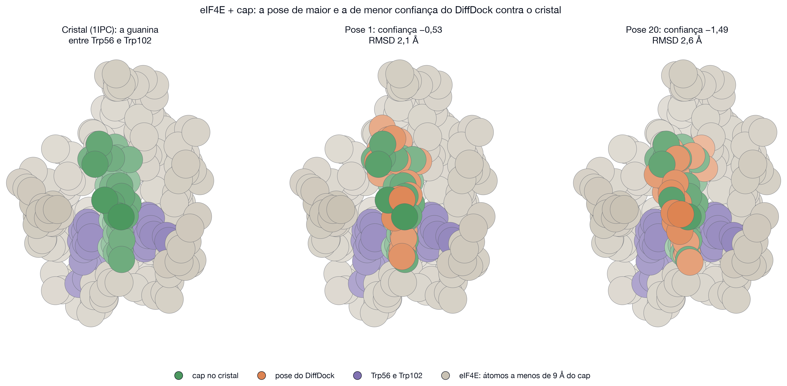

**O que se vê.** A pose 1 põe a guanina entre os dois triptofanos, a 2,1 Å do cristal (0,8 Å só na guanina), e repete os 6 contatos do cristal. Até a pose 20, a de menor confiança, fica a 2,6 Å.

### Passo 6: sistema B, rodar o exemplo da Mpro

**6.1.** No menu de exemplos, escolha **SARS-CoV-2 Main Protease and Ensitrelvir Analog**. Os campos se preenchem sozinhos: Molecule = `Ensitrelvir_analog_3d.sdf` e Target Protein = `mpro_chain_OpenFold_processed_ms.pdb`.

**6.2.** Confira 20 poses, 18 passos e 20 divisões de tempo e clique em **Run**. A referência levou 24,7 s.

**6.3.** Baixe as poses, ou use [resultados/mpro_diffdock/poses.sdf](resultados/mpro_diffdock/poses.sdf).

**O que muda em relação ao sistema A.** O receptor não veio de um cristal: é a Mpro predita pelo OpenFold, que fica a 0,58 Å (carbonos alfa) da Mpro da 8HBK. O ligante não é o do cristal: o análogo divide 29 dos 37 átomos pesados com o ensitrelvir. Não existe gabarito exato; o mais perto é o ensitrelvir na 8HBK.

### Passo 7: sistema B contra o cristal 8HBK

**7.1.** O modelo OpenFold está em outro sistema de coordenadas. Use os arquivos já sobrepostos à 8HBK pelos carbonos alfa: [receptor_openfold_no_8hbk.pdb](resultados/mpro_diffdock/receptor_openfold_no_8hbk.pdb) e [poses_no_8hbk.sdf](resultados/mpro_diffdock/poses_no_8hbk.sdf).

**7.2.** No Mol*, abra os dois arquivos e o ensitrelvir do cristal, [dados/mpro/ligante_cristal.sdf](dados/mpro/ligante_cristal.sdf).

**7.3.** Compare só o núcleo que as duas moléculas dividem: triazinatriona, indazol e trifluorobenzila.

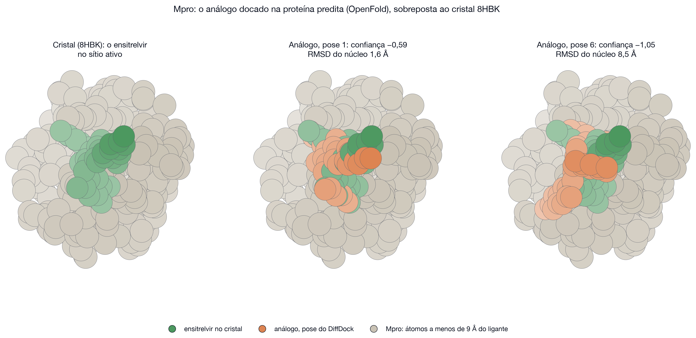

**O que se vê.** A pose 1 põe o núcleo a 1,6 Å do ensitrelvir do cristal, no sítio ativo, mesmo com a proteína predita. A pose 6 cai a 8,5 Å, já com confiança −1,05.

### Passo 8: a confiança acompanha o acerto?

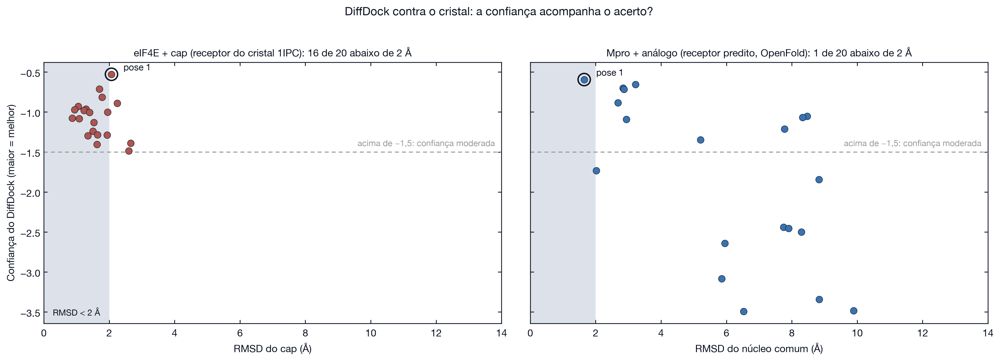

| | Sistema A: eIF4E + cap | Sistema B: Mpro + análogo |
|---|---|---|
| Confiança da pose 1 | −0,53 | −0,59 |
| RMSD da pose 1 | 2,07 Å (cap inteiro) | 1,65 Å (núcleo comum) |
| Poses abaixo de 2 Å | 16 de 20 | 1 de 20 |
| Contatos do cristal na pose 1 | 6 de 6 | 3 de 8 |

**No sistema A, o DiffDock reproduz o cristal.** As 20 poses põem a guanina entre os triptofanos, e a pose 1 repete os seis contatos, incluindo as pontes salinas dos fosfatos.

**Leia com cuidado.** A versão da NVIDIA (DiffDock 2.3) foi treinada com complexos do PDB reunidos nos conjuntos PLINDER e SAIR, e a 1IPC está no PDB desde 2002. O modelo pode ter visto este complexo, ou outros quase iguais da eIF4E com o cap. O acerto mostra o que ele aprendeu e não prova que ele acertaria uma molécula nova.

**No sistema B, a tarefa é mais dura e o resultado é mais honesto.** Proteína predita e uma molécula que não está no PDB: só a pose 1 fica abaixo de 2 Å, e as poses de confiança baixa caem longe do sítio. Aqui a confiança separa bem as poses boas das ruins.

**O cristal é o juiz.** Sem a 1IPC e a 8HBK não haveria como saber quais poses estão certas.

### Passo 9: ver as interações no PLIP

**9.1.** Abra o [PLIP](https://plip-tool.biotec.tu-dresden.de/plip-web/plip/index), digite **1IPC** no campo do código PDB e clique em **Run analysis**. Repita com **8HBK**.

**9.2.** Leia a tabela do ligante (MGP na 1IPC, 7YY na 8HBK) por tipo de interação.

**9.3.** Envie a pose 1 junto com o receptor do mesmo sistema de coordenadas, num arquivo só, e compare as listas resíduo por resíduo. O PLIP precisa da proteína e do ligante no mesmo arquivo, com o ligante marcado como `HETATM`.

**Caminho curto.** Os complexos prontos da pose 1 estão em [resultados/eif4e_diffdock/complexo_pose1.pdb](resultados/eif4e_diffdock/complexo_pose1.pdb) e [resultados/mpro_diffdock/complexo_pose1.pdb](resultados/mpro_diffdock/complexo_pose1.pdb).

**Caminho manual.**

1. Converta a pose 1 de SDF para PDB, por exemplo com o Open Babel: `obabel poses.sdf -f 1 -l 1 -O pose1.pdb`.
2. Abra o receptor que combina com as poses num editor de texto simples e apague a última linha, `END`. Sistema A: `dados/eif4e/receptor.pdb` com `poses.sdf`. Sistema B: `receptor_openfold_no_8hbk.pdb` com `poses_no_8hbk.sdf`; misturar o receptor original com as poses sobrepostas põe o ligante fora da proteína.
3. Cole no fim do receptor as linhas de átomos de `pose1.pdb`.
4. Nas linhas coladas, troque `ATOM  ` por `HETATM`. Sem isso o PLIP trata o ligante como proteína e não analisa nada.
5. Acrescente `END` na última linha, salve como `complexo.pdb` e envie ao PLIP pelo botão de upload.


Na eIF4E, a pose 1 repete os 6 contatos do cristal. Na Mpro, o análogo repete 3 dos 8 contatos do ensitrelvir (Gly143, Glu166 e Met165), perde His41, Cys145 e Ser144 e ganha uma ligação de halogênio com Gln189, pelo bromo que o ensitrelvir não tem.

### O que concluir desta prática

1. No sistema A, o DiffDock acerta: 16 de 20 poses abaixo de 2 Å e os 6 contatos do cristal. O modelo pode ter visto este complexo no treino.
2. O sistema B é o caso real: proteína predita e molécula nova. A pose 1 acerta o núcleo (1,6 Å); as outras quase todas erram.
3. A confiança ajuda a separar as poses: as de confiança abaixo de −1,5 caem longe do sítio. Ela não é energia.
4. O cristal é o juiz. Com uma molécula nova, valide o protocolo antes com um redocking num complexo conhecido.

### Resultados de referência

| Pasta | Conteúdo |
|-------|----------|
| [resultados/eif4e_diffdock](https://github.com/madsondeluna/curso-docking/tree/main/resultados/eif4e_diffdock) | as 20 poses (`poses.sdf`), parâmetros, comparação com o cristal, interações e o complexo da pose 1 |
| [resultados/mpro_diffdock](https://github.com/madsondeluna/curso-docking/tree/main/resultados/mpro_diffdock) | as 20 poses, as mesmas sobrepostas à 8HBK, o receptor sobreposto, a comparação no núcleo comum, interações e o complexo da pose 1 |


## Referência técnica

### Estrutura do repositório

| Caminho | Conteúdo |
|---------|----------|
| `dados/<sistema>/` | receptor limpo, ligante do cristal, ligante 3D, SMILES em pH 7,4 e caixa |
| `dados/mpro_analogo/` | os dois arquivos do exemplo da NVIDIA: a Mpro predita pelo OpenFold e o análogo do ensitrelvir |
| `dados/<sistema>.zip` | os mesmos arquivos num pacote, para baixar com um clique |
| `resultados/<sistema>_diffdock/` | poses do DiffDock, confiança, comparação com o cristal e interações |
| `resultados/<sistema>/` | execuções com o Vina de versões anteriores do curso, mantidas como registro |
| `resultados/cavidades/` | cavidades previstas pelo P2Rank e distância até cada ligante |
| `tools/` | scripts que preparam as entradas, rodam os servidores e geram as figuras |

### Scripts

| Script | O que faz |
|--------|-----------|
| `tools/prepare_inputs.py` | monta `dados/` a partir dos códigos PDB |
| `tools/swissdock_cli.py` | roda o Vina no SwissDock pela API (versões anteriores do curso) |
| `tools/analyze_poses.py` | energia e RMSD de cada pose contra o cristal |
| `tools/compare_crystal.py` | RMSD do ligante inteiro, RMSD só da base e contatos do cristal recuperados, pose a pose |
| `tools/compare_analog.py` | sobrepõe o modelo OpenFold à 8HBK e compara as poses do análogo com o ensitrelvir no núcleo comum |
| `tools/interactions.py` | interações do complexo com o PLIP, para poses em PDBQT ou SDF |
| `tools/pockets.py` | cavidades no PrankWeb e comparação com os sítios reais |
| `tools/make_figures.py` | gera todas as figuras |
| `tools/export_results.py` | publica os resultados de referência e empacota as entradas |

### Erros comuns e o que fazer

| Sintoma | Causa provável | Solução |
|---------|----------------|---------|
| O DiffDock não aceita o ligante | arquivo com mais de uma molécula ou sem 3D | enviar um SDF com uma molécula, em 3D e com hidrogênios |
| As poses aparecem longe do cristal no Mol* | receptor predito em outro sistema de coordenadas | usar os arquivos `_no_8hbk`, já sobrepostos ao cristal |
| Energias muito melhores que o esperado | ligante grande demais ou com clash | olhar a pose, conferir a eficiência do ligante |
| O ligante sai com a carga errada | estado de protonação errado | usar os arquivos de `dados/`, já em pH 7,4 |
| RMSD impossível de calcular | falta a pose de referência | só dá para calcular em redocking |

### Ferramentas usadas

| Ferramenta | Papel | Acesso |
|------------|-------|--------|
| DiffDock (NVIDIA) | docking por aprendizado de máquina | conta gratuita |
| RCSB PDB | cristais de referência | livre, sem conta |
| PrankWeb (P2Rank) | cavidades | livre, sem conta |
| PLIP | interações | livre, sem conta |
| Mol* | visualização | livre, sem conta |
| ClusPro | proteína-proteína e peptídeo | livre, uso não comercial, conta opcional |


## Referências

- Corso, G.; Stärk, H.; Jing, B.; Barzilay, R.; Jaakkola, T. DiffDock: diffusion steps, twists, and turns for molecular docking. *International Conference on Learning Representations (ICLR)* **2023**. https://arxiv.org/abs/2210.01776
- Morris, G. M. *et al.* Automated docking using a Lamarckian genetic algorithm and an empirical binding free energy function. *J. Comput. Chem.* **1998**, *19*, 1639-1662. https://doi.org/10.1002/(SICI)1096-987X(19981115)19:14<1639::AID-JCC10>3.0.CO;2-B
- Friesner, R. A. *et al.* Glide: a new approach for rapid, accurate docking and scoring. 1. Method and assessment of docking accuracy. *J. Med. Chem.* **2004**, *47*, 1739-1749. https://doi.org/10.1021/jm0306430
- Korb, O.; Stützle, T.; Exner, T. E. Empirical scoring functions for advanced protein-ligand docking with PLANTS. *J. Chem. Inf. Model.* **2009**, *49*, 84-96. https://doi.org/10.1021/ci800298z
- Schindler, T. *et al.* Structural mechanism for STI-571 inhibition of Abelson tyrosine kinase. *Science* **2000**, *289*, 1938-1942. https://doi.org/10.1126/science.289.5486.1938
- Sonenberg, N.; Hinnebusch, A. G. Regulation of translation initiation in eukaryotes: mechanisms and biological targets. *Cell* **2009**, *136*, 731-745. https://doi.org/10.1016/j.cell.2009.01.042
- Gingras, A.-C. *et al.* Regulation of 4E-BP1 phosphorylation: a novel two-step mechanism. *Genes Dev.* **1999**, *13*, 1422-1437. https://doi.org/10.1101/gad.13.11.1422
- Assouline, S. *et al.* Molecular targeting of the oncogene eIF4E in acute myeloid leukemia (AML): a proof-of-principle clinical trial with ribavirin. *Blood* **2009**, *114*, 257-260. https://doi.org/10.1182/blood-2009-02-205153
- Ma, J. C.; Dougherty, D. A. The cation-π interaction. *Chem. Rev.* **1997**, *97*, 1303-1324. https://doi.org/10.1021/cr9603744
- Tomoo, K. *et al.* Crystal structures of 7-methylguanosine 5'-triphosphate (m7GTP)- and P1-7-methylguanosine-P3-adenosine-5',5'-triphosphate (m7GpppA)-bound human full-length eukaryotic initiation factor 4E: biological importance of the C-terminal flexible region. *Biochem. J.* **2002**, *362*, 539-544. https://doi.org/10.1042/bj3620539
- Trott, O.; Olson, A. J. AutoDock Vina: improving the speed and accuracy of docking with a new scoring function, efficient optimization, and multithreading. *J. Comput. Chem.* **2010**, *31*, 455-461. https://doi.org/10.1002/jcc.21334
- Bugnon, M. *et al.* SwissDock 2024: major enhancements for small-molecule docking with Attracting Cavities and AutoDock Vina. *Nucleic Acids Res.* **2024**, *52*, W324-W332. https://doi.org/10.1093/nar/gkae300
- Jakubec, D. *et al.* PrankWeb 3: accelerated ligand-binding site predictions for experimental and modelled protein structures. *Nucleic Acids Res.* **2022**, *50*, W593-W597. https://doi.org/10.1093/nar/gkac389
- Jendele, L. *et al.* PrankWeb: a web server for ligand binding site prediction and visualization. *Nucleic Acids Res.* **2019**, *47*, W345-W349. https://doi.org/10.1093/nar/gkz424
- Le Guilloux, V.; Schmidtke, P.; Tuffery, P. Fpocket: an open source platform for ligand pocket detection. *BMC Bioinformatics* **2009**, *10*, 168. https://doi.org/10.1186/1471-2105-10-168
- Adasme, M. F. *et al.* PLIP 2021: expanding the scope of the protein-ligand interaction profiler to DNA and RNA. *Nucleic Acids Res.* **2021**, *49*, W530-W534. https://doi.org/10.1093/nar/gkab294
- Sehnal, D. *et al.* Mol* Viewer: modern web app for 3D visualization and analysis of large biomolecular structures. *Nucleic Acids Res.* **2021**, *49*, W431-W437. https://doi.org/10.1093/nar/gkab314
- Kozakov, D. *et al.* The ClusPro web server for protein-protein docking. *Nat. Protoc.* **2017**, *12*, 255-278. https://doi.org/10.1038/nprot.2016.169
- Porter, K. A. *et al.* ClusPro PeptiDock: efficient global docking of peptide recognition motifs using FFT. *Bioinformatics* **2017**, *33*, 3299-3301. https://doi.org/10.1093/bioinformatics/btx216
- Dominguez, C.; Boelens, R.; Bonvin, A. M. J. J. HADDOCK: a protein-protein docking approach based on biochemical or biophysical information. *J. Am. Chem. Soc.* **2003**, *125*, 1731-1737. https://doi.org/10.1021/ja026939x
- Kitchen, D. B.; Decornez, H.; Furr, J. R.; Bajorath, J. Docking and scoring in virtual screening for drug discovery: methods and applications. *Nat. Rev. Drug Discov.* **2004**, *3*, 935-949. https://doi.org/10.1038/nrd1549
- Fischer, E. Einfluss der Configuration auf die Wirkung der Enzyme. *Ber. Dtsch. Chem. Ges.* **1894**, *27*, 2985-2993. https://doi.org/10.1002/cber.18940270364
- Koshland, D. E. Application of a theory of enzyme specificity to protein synthesis. *Proc. Natl. Acad. Sci. USA* **1958**, *44*, 98-104. https://doi.org/10.1073/pnas.44.2.98
- Boehr, D. D.; Nussinov, R.; Wright, P. E. The role of dynamic conformational ensembles in biomolecular recognition. *Nat. Chem. Biol.* **2009**, *5*, 789-796. https://doi.org/10.1038/nchembio.232
- Unoh, Y. *et al.* Discovery of S-217622, a noncovalent oral SARS-CoV-2 3CL protease inhibitor clinical candidate for treating COVID-19. *J. Med. Chem.* **2022**, *65*, 6499-6512. https://doi.org/10.1021/acs.jmedchem.2c00117
- Gorre, M. E. *et al.* Clinical resistance to STI-571 cancer therapy caused by BCR-ABL gene mutation or amplification. *Science* **2001**, *293*, 876-880. https://doi.org/10.1126/science.1062538
- Shah, N. P. *et al.* Multiple BCR-ABL kinase domain mutations confer polyclonal resistance to the tyrosine kinase inhibitor imatinib (STI571) in chronic phase and blast crisis chronic myeloid leukemia. *Cancer Cell* **2002**, *2*, 117-125. https://doi.org/10.1016/S1535-6108(02)00096-X
- O'Hare, T. *et al.* AP24534, a pan-BCR-ABL inhibitor for chronic myeloid leukemia, potently inhibits the T315I mutant and overcomes mutation-based resistance. *Cancer Cell* **2009**, *16*, 401-412. https://doi.org/10.1016/j.ccr.2009.09.028
- Kussie, P. H. *et al.* Structure of the MDM2 oncoprotein bound to the p53 tumor suppressor transactivation domain. *Science* **1996**, *274*, 948-953. https://doi.org/10.1126/science.274.5289.948
- Vassilev, L. T. *et al.* In vivo activation of the p53 pathway by small-molecule antagonists of MDM2. *Science* **2004**, *303*, 844-848. https://doi.org/10.1126/science.1092472
- Zak, K. M. *et al.* Structure of the complex of human programmed death 1, PD-1, and its ligand PD-L1. *Structure* **2015**, *23*, 2341-2348. https://doi.org/10.1016/j.str.2015.09.010
- Lin, J.-H. *et al.* Computational drug design accommodating receptor flexibility: the relaxed complex scheme. *J. Am. Chem. Soc.* **2002**, *124*, 5632-5633. https://doi.org/10.1021/ja0260162
- Amaro, R. E. *et al.* Ensemble docking in drug discovery. *Biophys. J.* **2018**, *114*, 2271-2278. https://doi.org/10.1016/j.bpj.2018.02.038
- Genheden, S.; Ryde, U. The MM/PBSA and MM/GBSA methods to estimate ligand-binding affinities. *Expert Opin. Drug Discov.* **2015**, *10*, 449-461. https://doi.org/10.1517/17460441.2015.1032936
- Wang, L. *et al.* Accurate and reliable prediction of relative ligand binding potency in prospective drug discovery by way of a modern free-energy calculation protocol and force field. *J. Am. Chem. Soc.* **2015**, *137*, 2695-2703. https://doi.org/10.1021/ja512751q
- Zimmerman, M. I. *et al.* SARS-CoV-2 simulations go exascale to predict dramatic spike opening and cryptic pockets across the proteome. *Nat. Chem.* **2021**, *13*, 651-659. https://doi.org/10.1038/s41557-021-00707-0
- Jumper, J. *et al.* Highly accurate protein structure prediction with AlphaFold. *Nature* **2021**, *596*, 583-589. https://doi.org/10.1038/s41586-021-03819-2
- Kim, S. *et al.* PubChem 2023 update. *Nucleic Acids Res.* **2022**, *51*, D1373-D1380. https://doi.org/10.1093/nar/gkac956
- Weininger, D. SMILES, a chemical language and information system. 1. Introduction to methodology and encoding rules. *J. Chem. Inf. Comput. Sci.* **1988**, *28*, 31-36. https://doi.org/10.1021/ci00057a005
- Bogan, A. A.; Thorn, K. S. Anatomy of hot spots in protein interfaces. *J. Mol. Biol.* **1998**, *280*, 1-9. https://doi.org/10.1006/jmbi.1998.1843


## Licença

Este material está sob a licença MIT. Veja [LICENSE](LICENSE).
