# Docking Molecular: da estrutura à interação

Material didático e prática em servidores web sobre docking molecular: prever onde e como uma molécula pequena se encaixa numa proteína. A prática é o redocking do ensitrelvir na protease principal do SARS-CoV-2, em que o programa acerta a pose do cristal. Todos os arquivos de entrada estão neste repositório e baixam com um clique.

| Etapa | Ferramenta | Conta | Conteúdo |
|-------|------------|-------|----------|
| Docking | [SwissDock](https://www.swissdock.ch/) (AutoDock Vina) | não | redocking do ensitrelvir, energia e RMSD contra o cristal |
| Interações | [PLIP](https://plip-tool.biotec.tu-dresden.de/) | não | ligações de hidrogênio, contatos hidrofóbicos, empilhamento |
| Visualização | [Mol*](https://molstar.org/) | não | ver a pose e o sítio em 3D |

| Autoria | |
|---|---|
| Autor | **Madson A. de Luna-Aragão** |
| Vínculos | Programa Interunidades de Pós-Graduação em Bioinformática, Universidade Federal de Minas Gerais (UFMG), Belo Horizonte, Brasil<br>Centre National de la Recherche Scientifique (CNRS), Institut de Biologie et Chimie des Protéines (IBCP), Lyon, França |
| E-mail | [madsondeluna@gmail.com](mailto:madsondeluna@gmail.com) |
| Site do curso | [madsondeluna.com/curso-docking](https://madsondeluna.com/curso-docking/) |
| Repositório | [madsondeluna/curso-docking](https://github.com/madsondeluna/curso-docking) |
| Curso de dinâmica molecular | [madsondeluna.com/curso-md](https://madsondeluna.com/curso-md/) |


## Roteiro da aula

| Bloco | Conteúdo | Material |
|-------|----------|----------|
| 1 | O que o docking responde e o que não responde | seção 1 |
| 2 | Chave e fechadura, encaixe induzido, seleção conformacional | seção 2 |
| 3 | As forças que seguram o ligante | seção 3 |
| 3b | Energia de ligação: ΔG, Kd, ΔΔG entre poses, mutantes e ligantes | seção Energia de ligação |
| 4 | Tipos de sítio; nem toda cavidade é um sítio | seção 4 |
| 5 | Tipos de docking: flexibilidade, busca, parceiros | seção 5 |
| 6 | Níveis de modelagem e quanto cada um custa | seção 6 |
| 7 | De onde vêm receptores e ligantes; ler uma SMILES | seção 7 |
| 8 | Métricas: energia, RMSD, interações, eficiência | seção 8 |
| 9 | Mutações, resistência e câncer | seção 9 |
| 10 | Por que o docking precisa da dinâmica molecular | seção 10 |
| 11 | Prática: o ensitrelvir na Mpro do SARS-CoV-2 | seção Prática |


## 1. O que o docking molecular faz

O docking responde a duas perguntas sobre um par receptor e ligante: **onde** a molécula pequena se encaixa e **em que orientação e conformação**. O programa gera milhares de posições e orientações candidatas dentro de uma caixa de busca, calcula para cada uma um valor de energia com uma função de pontuação e devolve as melhores, ordenadas. Cada candidata é uma **pose**.

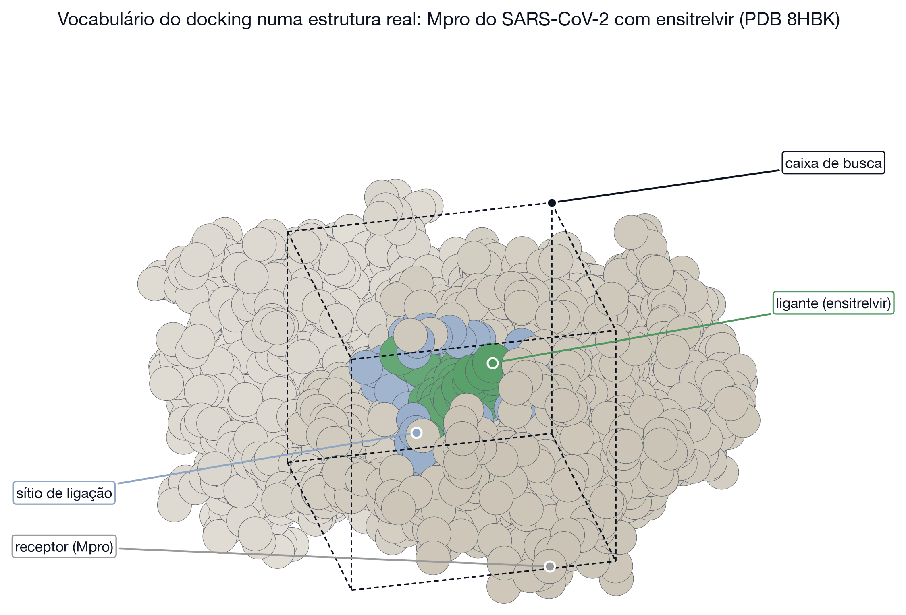

A pergunta que o docking **não** responde bem é quanto a molécula se liga de fato. A função de pontuação é uma aproximação rápida, calibrada em complexos conhecidos; ela acerta a geometria com muito mais frequência do que a afinidade. Prever a pose e prever a afinidade são problemas diferentes, e o segundo continua difícil (Kitchen *et al.*, 2004).

**Analogia: estacionar na vaga certa.** Achar a vaga e entrar nela com o carro na posição certa é a pose. Dizer quanto tempo o carro vai ficar estacionado é a afinidade. O docking faz a primeira tarefa bem e a segunda mal.

**Exemplo saudável.** A eIF4E e milhares de outras proteínas funcionam porque reconhecem o parceiro certo entre milhares de moléculas na célula. A eIF4E segura o cap do mRNA, uma guanina metilada, e assim decide quais mensagens serão traduzidas.

**Exemplo patológico e translacional.** O ensitrelvir, antiviral oral contra a COVID-19, foi descoberto por triagem virtual seguida de desenho baseado em estrutura: um programa de docking testou uma biblioteca interna contra a protease principal do vírus, e os compostos escolhidos foram otimizados a partir das estruturas (Unoh *et al.*, 2022). É o fármaco da prática.


## 2. Como o ligante reconhece o receptor

Três modelos explicam o encaixe, em ordem histórica, e todos continuam úteis.

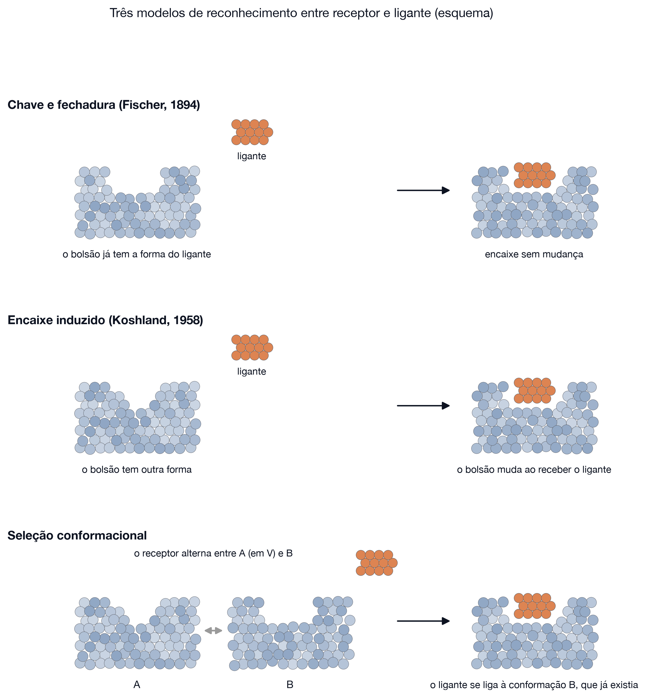

| Modelo | Ideia | Consequência para o docking |
|--------|-------|------------------------------|
| Chave e fechadura (Fischer, 1894) | o bolsão já tem a forma do ligante | basta testar posições e orientações do ligante rígido |
| Encaixe induzido (Koshland, 1958) | o bolsão muda ao receber o ligante | um receptor rígido pode não ter a forma certa |
| Seleção conformacional (Boehr, Nussinov e Wright, 2009) | o receptor oscila entre formas; o ligante escolhe uma | a forma certa pode não ser a do cristal que você baixou |


## 3. As forças que seguram o ligante

A energia de um complexo vem de interações fracas somadas, mais o custo de tirar a água do caminho.

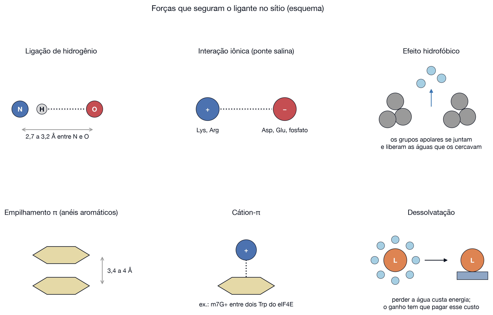

| Força | Alcance típico |
|-------|----------------|
| Ligação de hidrogênio | 2,7 a 3,2 Å entre os átomos pesados |
| Interação iônica (ponte salina) | alguns ångströms, depende do meio |
| Efeito hidrofóbico | contato entre superfícies apolares |
| Empilhamento π | 3,4 a 4 Å entre anéis |
| Cátion-π | anel aromático e carga positiva |
| Dessolvatação | custo de remover a água |

**Analogia: velcro.** Nenhum gancho segura sozinho; o conjunto segura. Tirar um gancho enfraquece pouco, tirar metade solta tudo.


## Energia de ligação: ΔG e ΔΔG

Todo número que o docking devolve é uma estimativa de ΔG de ligação. Esta seção diz o que esse número significa, como ele se liga à afinidade medida em bancada e o que é o ΔΔG, a diferença entre dois ΔG.

**O que é ΔG de ligação.** É a diferença de energia livre entre o complexo e as duas moléculas separadas:

$$\Delta G_{lig} = G_{complexo} - (G_{receptor} + G_{ligante})$$

ΔG negativo quer dizer que a ligação acontece espontaneamente; quanto mais negativo, mais estável o complexo.

**Analogia: o poço.** Receptor e ligante separados ficam no nível de referência. Ao se ligarem, o sistema desce para um poço, e o ΔG é a profundidade dele. Num poço fundo o ligante precisa de muita energia para sair e passa mais tempo ligado; num poço raso ele sai com facilidade.

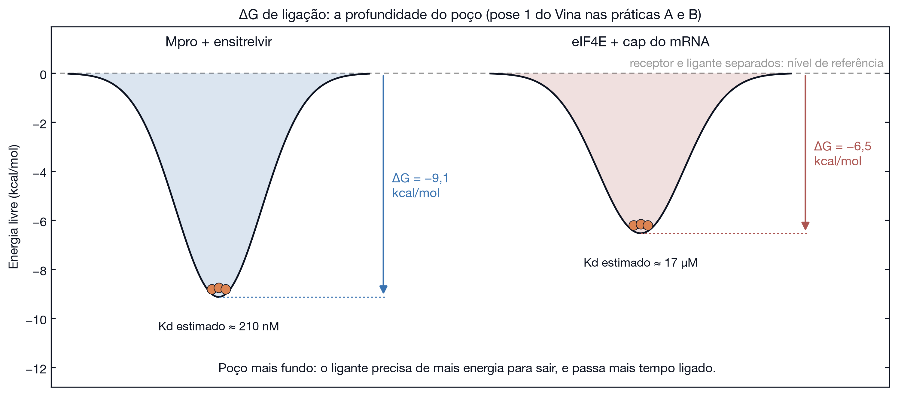

**ΔG e Kd.** A constante de dissociação Kd é a concentração de ligante em que metade dos receptores está ocupada. As duas grandezas se relacionam por ΔG = RT ln Kd, com Kd em mol/L e RT = 0,593 kcal/mol a 25 °C. A escala é logarítmica: cada 1,36 kcal/mol mais negativo divide o Kd por 10.

| ΔG (kcal/mol) | Kd | Leitura |
|---------------|----|---------|
| −4,1 | 1 mM | ligação muito fraca, típica de fragmentos |
| −8,2 | 1 µM | ponto de partida comum de um composto ativo |
| −12,3 | 1 nM | afinidade típica de um fármaco otimizado |
| −16,4 | 1 pM | ligação muito forte, como a de anticorpos de alta afinidade |

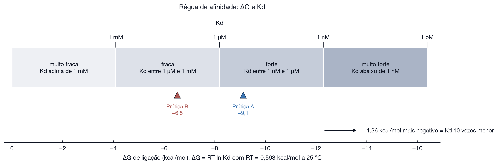

**O que o docking calcula.** A energia do AutoDock Vina é uma função empírica: soma termos de contato estérico, ligação de hidrogênio e contato hidrofóbico, com pesos ajustados para reproduzir afinidades medidas, e divide o total por 1 + 0,0585 × N, em que N é o número de ligações rotáveis do ligante, uma correção grosseira para a liberdade perdida (Trott e Olson, 2010). A função não tem termo eletrostático explícito, trata a água de forma implícita e mantém o receptor rígido. No conjunto de treino, o erro padrão foi de 2,85 kcal/mol, o equivalente a um fator de cerca de 100 no Kd.

**ΔG entre poses.** Para o mesmo ligante no mesmo receptor, cada pose recebe um ΔG, e o programa as ordena por ele. A diferença entre duas poses é pequena perto do erro da função:

| Sistema | Pose 1 | Pose comparada | Diferença | RMSD das duas |
|---------|--------|----------------|-----------|---------------|
| Mpro, ensitrelvir | −9,13 | pose 2: −8,71 | 0,42 kcal/mol | 1,5 Å contra 8,3 Å |
| eIF4E, cap do mRNA | −6,53 | pose 16: −4,98 | 1,55 kcal/mol | 6,5 Å contra 4,3 Å |

Na Mpro, a pose certa e uma pose 8 Å fora estão separadas por 0,42 kcal/mol. Na eIF4E, a pose mais próxima do cristal fica 1,55 kcal/mol pior que a primeira. As duas diferenças estão dentro dos 2,85 kcal/mol de erro: a energia sozinha não decide entre elas.

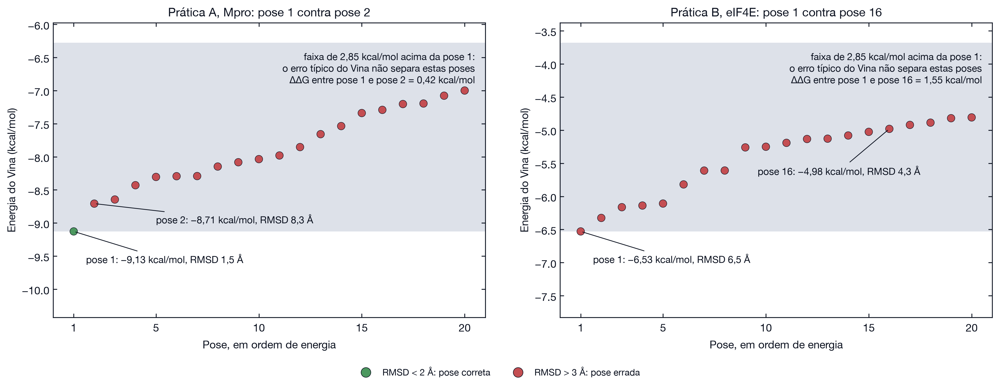

**ΔΔG.** É a diferença entre dois ΔG. Comparando uma proteína mutante com a selvagem, para o mesmo ligante:

$$\Delta\Delta G = \Delta G_{mutante} - \Delta G_{selvagem}$$

| ΔΔG | Significado | Efeito no Kd |
|-----|-------------|--------------|
| positivo | a mutação deixa o poço mais raso e enfraquece a ligação | Kd maior |
| perto de zero | a mutação não altera a ligação | igual |
| negativo | a mutação aprofunda o poço e fortalece a ligação | Kd menor |

A mesma conta compara dois ligantes no mesmo receptor, ΔG(ligante B) − ΔG(ligante A), e é a base para decidir qual análogo sintetizar. Um ΔΔG de 1,36 kcal/mol multiplica o Kd por 10; 2,73 kcal/mol, por 100.

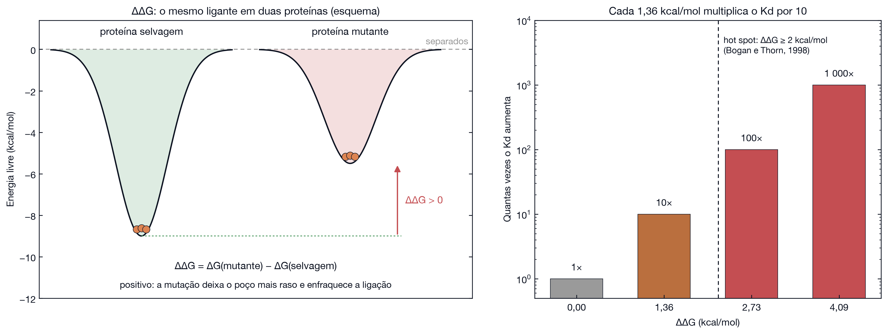

**Exemplo saudável: hot spots de interfaces.** Trocando resíduos por alanina, um a um, e medindo o ΔΔG de cada troca em 2 325 mutantes, Bogan e Thorn (1998) mostraram que a energia de uma interface proteína-proteína se concentra em poucos resíduos, os hot spots, ricos em triptofano, tirosina e arginina e cercados por resíduos que afastam a água. Na barnase e na barstar, pares de resíduos carregados contribuem com 1,6 a 7 kcal/mol de energia de acoplamento (Schreiber e Fersht, 1995).

**Exemplo patológico: resistência.** A mutação T315I da ABL é um ΔΔG positivo para o imatinibe: o fármaco perde a ligação de hidrogênio com a Thr315 e esbarra na isoleucina, enquanto a enzima continua ligando o ATP (seção 9). A resistência a um fármaco é, em termos de energia, uma mutação com ΔΔG grande para o fármaco e pequeno para o substrato natural.

**O que o docking diz sobre ΔΔG.** No cap da eIF4E (resultado de referência em `resultados/eif4e`), o cap completo (m7GTP, três fosfatos) e o m7GMP (um fosfato) receberam −6,53 e −6,44 kcal/mol: ΔΔG de 0,09 kcal/mol, embora no cristal os três fosfatos façam pontes salinas com Arg157, Lys162 e Glu103. Diferenças de 1 a 2 kcal/mol ficam abaixo do que o docking resolve. Para ΔΔG nessa faixa, os cálculos de perturbação de energia livre chegam a um erro próximo de 1 kcal/mol (Wang *et al.*, 2015), ao custo de dias em GPU (seção 6).


## 4. Onde o ligante se encaixa: tipos de sítio

Uma cavidade é um buraco na superfície da proteína. Um sítio de ligação é uma cavidade onde algo se liga de fato. **Toda proteína tem muito mais cavidades do que sítios.**


| Tipo de sítio | O que é | Exemplo verificado nesta aula |
|---------------|---------|-------------------------------|
| Ortostérico | onde o substrato ou ligante natural se liga | sítio do ATP da quinase ABL, com nilotinibe (PDB 5MO4) |
| Alostérico | outro lugar da mesma proteína; ligar ali muda a atividade do sítio ortostérico | bolso do miristoil da ABL, com asciminibe (mesma estrutura) |
| Críptico | só se abre quando o ligante chega; não aparece, ou aparece raso, na estrutura livre | bolso switch II do KRAS G12C, com sotorasibe (PDB 6OIM) |
| Interface proteína-proteína | superfície larga e rasa que recebe outra proteína | sulco do MDM2 que recebe a hélice da p53 (PDB 1YCR) |

**Nem toda cavidade é um sítio.** O P2Rank, pelo PrankWeb, devolve as cavidades de uma estrutura ordenadas por um escore. Na Mpro são oito cavidades e só a primeira é o sítio ativo. As outras sete ficam de 8 a 26 Å do ensitrelvir: são reentrâncias da superfície sem ligante conhecido.


**Cuidados ao olhar uma cavidade.**

- Buracos onde ficam glicerol, PEG, sulfato ou tampão no cristal costumam ser artefatos da cristalização, não sítios.
- Cavidades em interfaces entre cópias da proteína no cristal podem não existir na célula.
- Uma interface proteína-proteína raramente é uma cavidade funda, e por isso escapa de quem só procura bolsões.
- Um escore alto diz que a cavidade **parece** um sítio, não que algum ligante se ligue ali.


## 5. Tipos de docking

**Pela flexibilidade.**

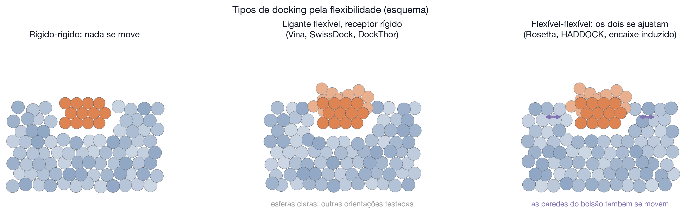

| Tipo | O que se move | Custo | Programas |
|------|---------------|-------|-----------|
| Rígido-rígido | nada | muito baixo | buscas por forma, triagem inicial |
| Ligante flexível, receptor rígido | ligações rotáveis do ligante | baixo | AutoDock Vina, SwissDock, DockThor |
| Flexível-flexível | ligante e cadeias laterais, ou mais | alto | Rosetta, HADDOCK |

**Pelo que se sabe do sítio.**

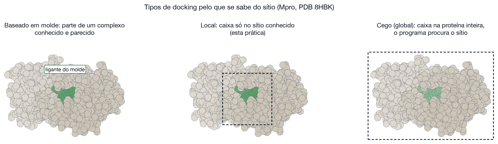

| Tipo | Quando usar | Risco |
|------|-------------|-------|
| Baseado em molde | existe complexo parecido resolvido | depende de o molde ser mesmo parecido |
| Local | o sítio é conhecido (esta prática) | se a caixa estiver errada, a resposta está errada |
| Cego (global) | o sítio é desconhecido | muitas cavidades candidatas, mais falsos positivos |

**Pelos parceiros.** Proteína e molécula pequena é o caso desta prática. Proteína e peptídeo e proteína e proteína pedem outros programas, porque a superfície de contato é larga e rasa.

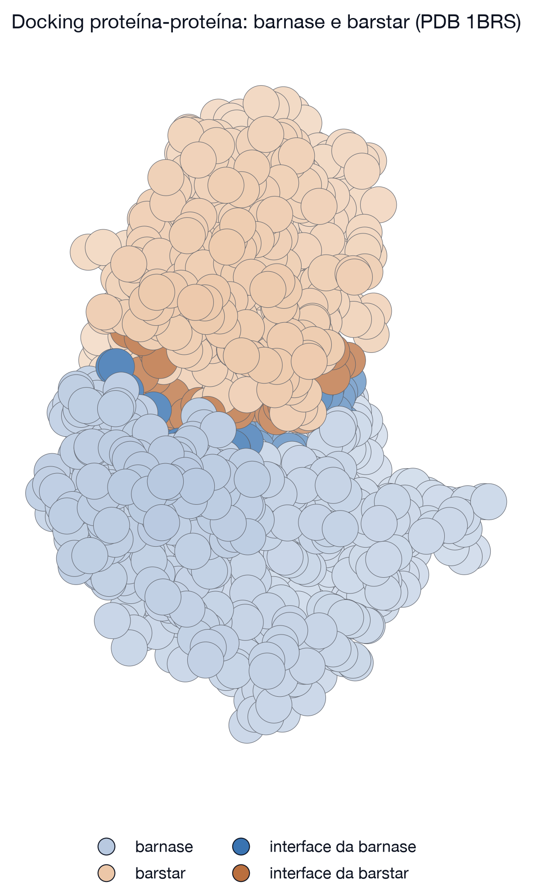

A barnase e a barstar formam um dos complexos mais fortes já medidos entre duas proteínas, com uma interface de dezenas de resíduos (Buckle, Schreiber e Fersht, 1994). Para esse tipo de problema existem servidores próprios, como o [ClusPro](https://cluspro.bu.edu/), que também tem modo para peptídeos (Kozakov *et al.*, 2017; Porter *et al.*, 2017).


## 6. Níveis de modelagem e quanto cada um custa

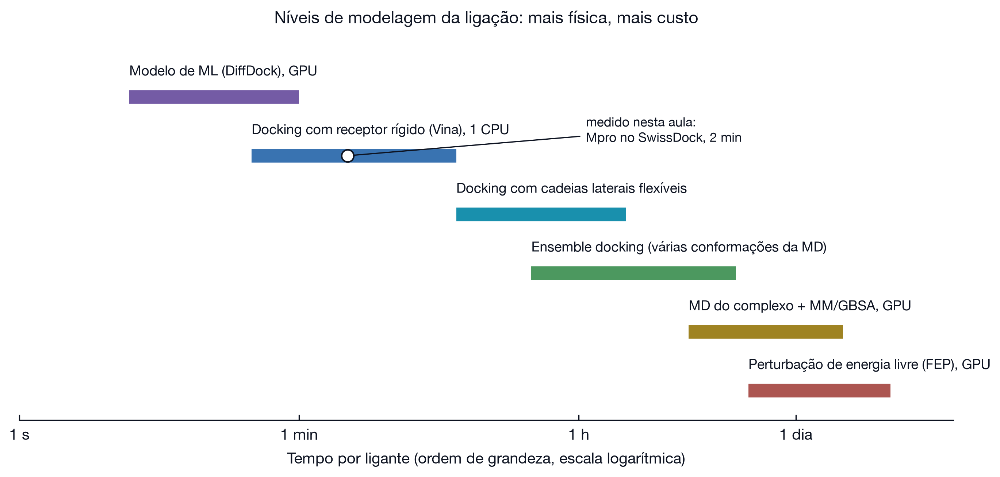

| Nível | O que modela | O que você ganha | Ordem de grandeza por ligante |
|-------|--------------|------------------|-------------------------------|
| Modelo de aprendizado de máquina | aprende poses a partir do PDB | velocidade | segundos em GPU |
| Docking com receptor rígido | forma e interações, ligante flexível | pose, ranking grosseiro | 2 min medidos nesta aula |
| Docking com cadeias laterais flexíveis | parte do encaixe induzido | sítios que precisam abrir | dezenas de minutos |
| Ensemble docking | várias conformações do receptor, vindas da dinâmica | receptor que se move | horas (Amaro *et al.*, 2018) |
| Dinâmica molecular com MM/GBSA | o complexo em água, com movimento | estabilidade da pose e energia melhor | horas a dias (Genheden e Ryde, 2015) |
| Perturbação de energia livre (FEP) | diferença de energia livre entre dois ligantes | a melhor previsão de afinidade disponível | dias em GPU (Wang *et al.*, 2015) |

**Como escolher o nível.** Use o mais barato que responda à sua pergunta. Para escolher 50 compostos entre um milhão, docking rígido basta. Para decidir qual de dois análogos sintetizar, docking não basta.


## 7. De onde vêm receptores e ligantes

**Receptores.** O Protein Data Bank guarda estruturas resolvidas por cristalografia de raios X, ressonância magnética nuclear e crio-microscopia eletrônica. Toda estrutura tem limitações que afetam o docking:

| O que olhar na estrutura | Por que importa |
|--------------------------|-----------------|
| Resolução | abaixo de 2,5 Å as cadeias laterais do sítio são confiáveis |
| Ligante presente | uma estrutura com ligante parecido já tem o sítio aberto |
| Resíduos faltando | alças não resolvidas podem fazer parte do sítio |
| Hidrogênios | quase nunca estão no cristal; o programa os adiciona |
| Moléculas do tampão | glicerol, PEG e sulfato ocupam cavidades sem serem ligantes |

Modelos previstos, como os do AlphaFold (Jumper *et al.*, 2021), ampliaram muito a oferta de receptores, mas trazem o problema da seção 2: a conformação prevista pode não ser a que recebe o ligante.

**Ligantes.** PDB, PubChem (Kim *et al.*, 2022), ChEMBL e DrugBank fornecem estruturas e identificadores. A forma mais portátil de escrever uma molécula pequena é a SMILES, uma linha de texto (Weininger, 1988).

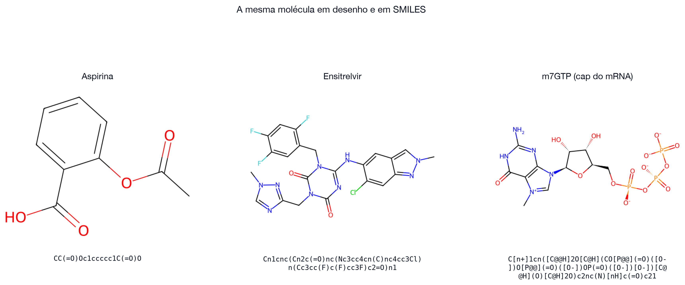

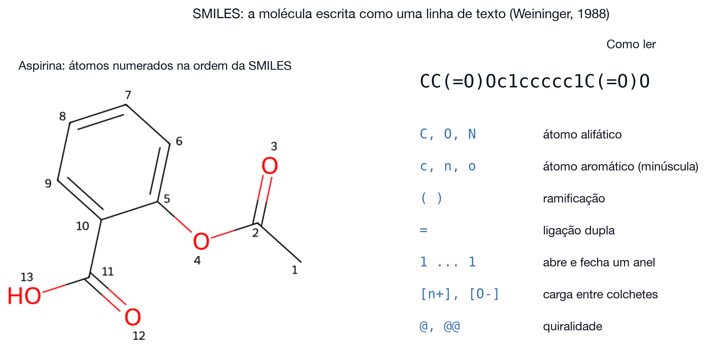

**Como obter a SMILES de um ligante, na prática.**

1. No RCSB PDB: abra a página do ligante, por exemplo [o ligante 7YY](https://www.rcsb.org/ligand/7YY), e copie a linha SMILES isomérica.
2. No PubChem: busque pelo nome do composto e copie a SMILES canônica ou isomérica.
3. No próprio SwissDock: desenhe a molécula no editor e deixe o servidor gerar a SMILES.
4. A partir de um arquivo que você já tem: o Open Babel converte SDF, MOL2 ou PDB em SMILES.

**Protonação importa.** A mesma molécula tem cargas diferentes em pH diferente. O cap m7GTP, em pH 7,4, fica com carga total −3, por causa dos três fosfatos. Ao colar uma SMILES no SwissDock, o servidor lista os estados possíveis e pede que você escolha; o material desta aula usa sempre o estado de pH 7,4, já gravado em `dados/`.


## 8. Métricas: como ler um resultado de docking

Quatro números, e o que conta como bom e como ruim em cada um.

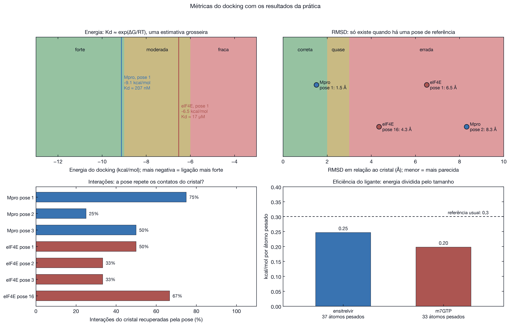

| Métrica | O que mede | Bom | Ruim | Armadilha |
|---------|-----------|-----|------|-----------|
| Energia (kcal/mol) | pontuação da função do programa | abaixo de −9 | acima de −6 | não é energia livre medida; não compara entre programas |
| RMSD (Å) | distância média entre a pose e uma referência | abaixo de 2 | acima de 3 | só existe quando há pose de referência |
| Interações recuperadas | contatos do cristal que a pose repete | acima de 70% | abaixo de 30% | contar contato sem olhar quais contatos engana |
| Eficiência do ligante | energia dividida pelo número de átomos pesados | acima de 0,3 | abaixo de 0,2 | molécula grande ganha energia por tamanho, não por encaixe |

**Como o RMSD é calculado.** Para cada átomo pesado, mede-se a distância entre a posição na pose e a posição no cristal; o RMSD é a raiz da média dos quadrados dessas distâncias. O limiar de 2 Å é convenção da área: abaixo dele, a pose reproduz os mesmos contatos.

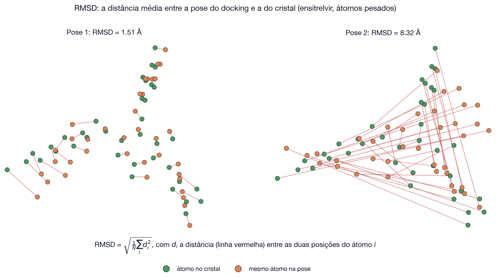

**Interações.** O PLIP lista as interações de um complexo por resíduo e por tipo (Adasme *et al.*, 2021). Comparando a pose com o cristal, dá para ver não só quantas interações se repetem, mas quais.

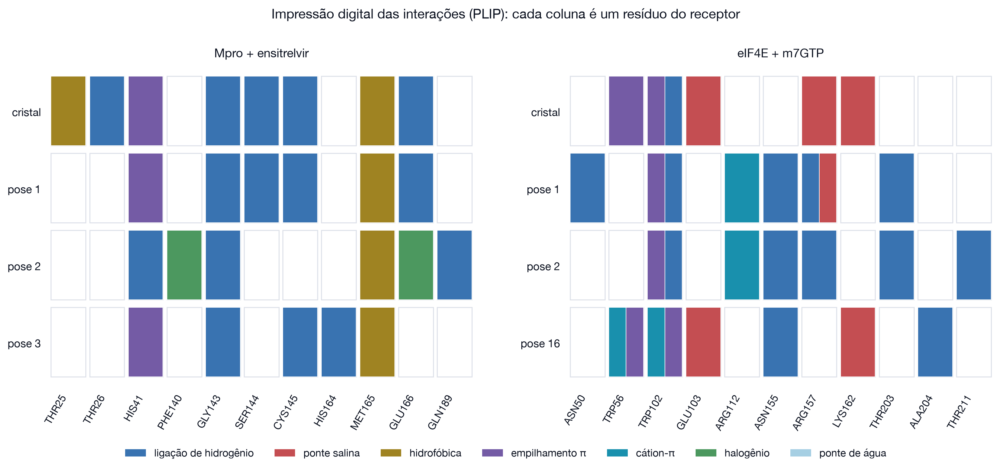


## 9. Mutações, resistência e câncer

Uma troca de um único resíduo no sítio muda o encaixe e pode anular um fármaco.

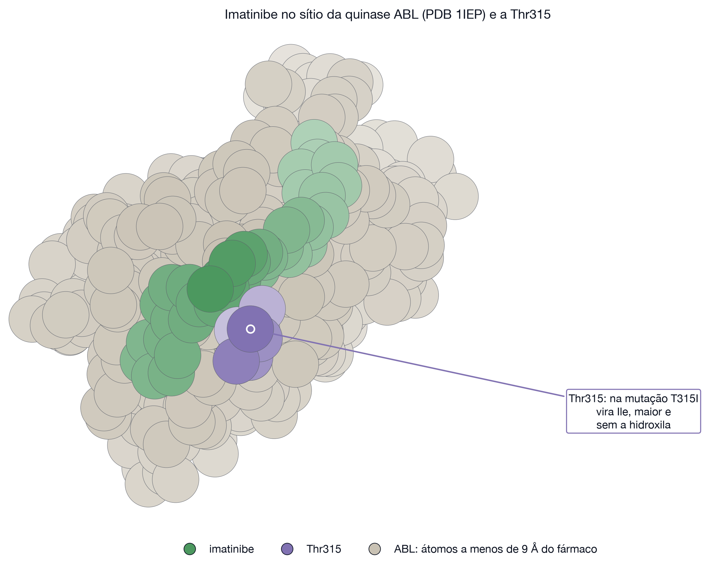

**Leucemia mieloide crônica.** O imatinibe se liga ao sítio do ATP da quinase BCR-ABL. A troca da treonina 315 por isoleucina, T315I, remove uma hidroxila que fazia ligação de hidrogênio com o fármaco e põe uma cadeia lateral maior no caminho. Pacientes com essa mutação deixam de responder (Gorre *et al.*, 2001; Shah *et al.*, 2002). A saída veio em duas frentes: o ponatinibe, desenhado para contornar o volume extra (O'Hare *et al.*, 2009), e o asciminibe, que vai para o sítio alostérico.

**Proteína-proteína e fármaco no mesmo sítio.** O MDM2 segura a p53 por um sulco que recebe três resíduos da hélice: Phe19, Trp23 e Leu26 (Kussie *et al.*, 1996). As nutlinas ocupam esse mesmo sulco e soltam a p53, reativando a resposta ao dano no DNA (Vassilev *et al.*, 2004). Um sítio que existe para receber uma proteína pode receber um fármaco.

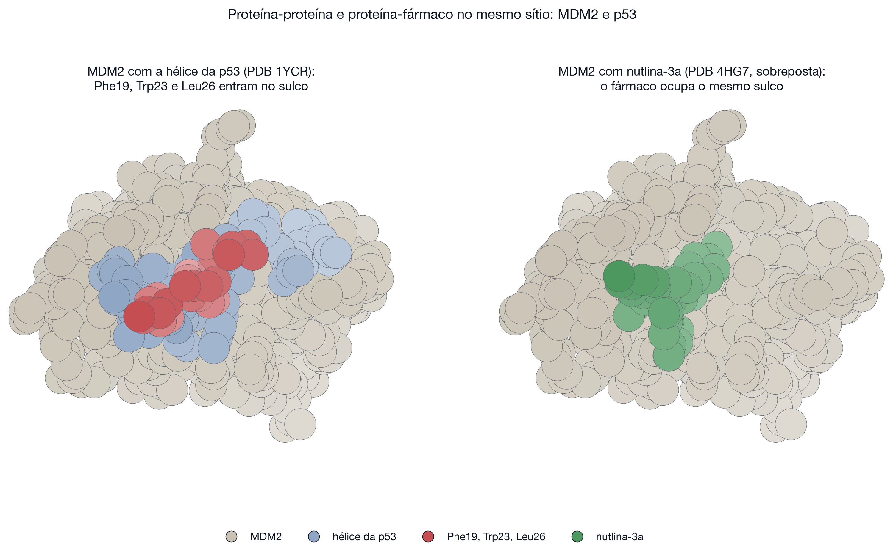

**O que o docking consegue dizer sobre uma mutação.** Com cuidado: comparar a pose e a energia no selvagem e no mutante dá uma indicação, mas o receptor rígido não reproduz o rearranjo que costuma acompanhar a mutação. Para isso, a seção 10.


## 10. Por que o docking precisa da dinâmica molecular

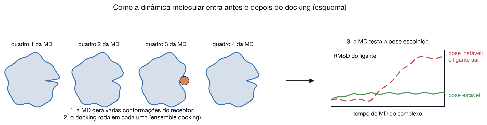

| Momento | O que a dinâmica faz | Por quê |
|---------|---------------------|---------|
| Antes | gera várias conformações do receptor para rodar o docking em cada uma | o receptor rígido é a maior limitação do método (Lin *et al.*, 2002; Amaro *et al.*, 2018) |
| Antes | revela bolsos crípticos que não aparecem no cristal | foi assim que se encontraram mais de 50 bolsos nas proteínas do SARS-CoV-2 (Zimmerman *et al.*, 2021) |
| Depois | testa se a pose se mantém em água, a 310 K | uma pose boa no escore pode se desfazer em poucos nanossegundos |
| Depois | estima a energia com MM/GBSA ou FEP | funções de pontuação de docking são rápidas, não exatas |

**Como testar a estabilidade de uma pose.** Simule o complexo e acompanhe o RMSD do ligante ao longo do tempo. Se ele oscila numa faixa estreita, a pose é estável. Se cresce e o ligante sai do sítio, o docking entregou uma pose plausível na geometria e errada na física.

O curso de dinâmica molecular deste mesmo conjunto cobre essa parte: [madsondeluna.com/curso-md](https://madsondeluna.com/curso-md/).


## Prática: o ensitrelvir na Mpro do SARS-CoV-2


**A proteína e o fármaco.** A protease principal (Mpro, ou 3CL) corta a poliproteína do vírus em pontos específicos; sem ela, o vírus não se replica. O ensitrelvir é um inibidor não covalente, de uso oral, aprovado no Japão. A estrutura 8HBK traz os dois juntos, a 1,8 Å.

**Redocking.** Apagar o fármaco, entregar ao programa só a proteína, pedir que ele descubra onde a molécula se encaixa e comparar com a posição verdadeira, que ficou guardada. O teste mede se o protocolo recupera uma resposta conhecida: é o requisito mínimo antes de usá-lo em moléculas cuja pose ninguém conhece.

### Antes de começar

Precisa só de um navegador. Nenhum dos serviços pede cadastro.

**Baixe o pacote de entradas:** [dados/mpro.zip](dados/mpro.zip) e descompacte.

| Arquivo | O que é | Usado no passo |
|---------|---------|----------------|
| `receptor.pdb` | cadeia A da 8HBK, só proteína | 3 |
| `ligante.smi` | SMILES do ensitrelvir em pH 7,4 | 2 |
| `caixa.json` | centro e tamanho da caixa | 4 |
| `ligante_cristal.sdf` | ensitrelvir na posição verdadeira | 7 |
| `ligante_3d.sdf` e `.mol2` | ligante em 3D com hidrogênios | alternativa ao passo 2 |

### Passo 1: inspecionar a estrutura no PDB

**1.1.** Abra [rcsb.org/structure/8HBK](https://www.rcsb.org/structure/8HBK).

**1.2.** Na caixa **Experimental Data Snapshot**, no alto à direita, confira:

| Campo | Valor esperado | Por que você confere |
|-------|----------------|----------------------|
| Method | X-RAY DIFFRACTION | as posições dos átomos são medidas, não previstas |
| Resolution | 1.60 a 1.80 Å | abaixo de 2,5 Å as cadeias laterais do sítio são confiáveis |

**1.3.** Role até **Macromolecules** e confirme que existe uma cadeia A de proteína. Em **Small Molecules**, confirme o ligante de código **7YY**: é o ensitrelvir.

**1.4.** Clique em **3D View**. Abre o visualizador Mol*. Gire com o botão esquerdo do mouse e aproxime com a roda até ver o ligante, em bastões, dentro de uma fenda da proteína.

**Por que este passo existe.** O programa de docking não sinaliza quando a estrutura é inadequada: ele devolve energias em qualquer caso. Resolução baixa, alças não resolvidas ou sítio fechado produzem resultados sem significado e com aparência normal.

**O que você deve ver.** Uma molécula alongada ocupando uma fenda entre dois domínios da proteína. Essa fenda é o sítio ativo, e é ali que a caixa do passo 4 vai ficar.


### Passo 2: informar o ligante no SwissDock

**2.1.** Abra [swissdock.ch](https://www.swissdock.ch/) e vá para a página de submissão.

**2.2.** No campo do **ligante**, entre as opções de SMILES, arquivo Mol2 e desenho, escolha **SMILES**.

**2.3.** Abra o arquivo `ligante.smi` num editor de texto e copie a linha, ou copie daqui:

```
Cn1cnc(Cn2c(=O)nc(Nc3cc4cn(C)nc4cc3Cl)n(Cc3cc(F)c(F)cc3F)c2=O)n1
```

**2.4.** Cole no campo e confirme.

**2.5.** O servidor responde com uma lista de **estados de protonação**, cada um com a faixa de pH em que predomina. **Escolha o da faixa que contém 7,4.** Para o ensitrelvir, esse estado tem carga total 0.

**Por que a protonação é uma escolha de verdade.** A mesma molécula tem cargas diferentes conforme o pH. Carga muda quais interações são possíveis: um grupo que deveria fazer ponte salina, se entrar neutro, simplesmente não faz. O pH 7,4 é o do sangue e do meio extracelular, e é o padrão quando se quer representar o ambiente fisiológico.

**Alternativa ao SMILES.** Se preferir enviar arquivo, use `ligante_3d.mol2`. O servidor exige um arquivo com **uma só molécula, com todos os hidrogênios e coordenadas 3D**, e esse arquivo já atende às três condições.

**O que esperar.** A mensagem de que o ligante foi preparado e um **número de sessão**. Anote esse número: é por ele que você acompanha e recupera o trabalho.

### Passo 3: informar o receptor

**3.1.** No campo do **alvo**, escolha enviar arquivo e selecione `receptor.pdb`.

**3.2.** Confirme o envio.

**Por que enviar o arquivo em vez de digitar o código 8HBK.** O servidor aceita o código e deixa você escolher cadeias e heteroátomos ali mesmo. Funciona, mas o arquivo do pacote já foi limpo da mesma forma para todos, o que torna os resultados comparáveis entre os alunos e evita erro de seleção.

**O que já foi retirado desse arquivo, e por quê.**

| Removido | Motivo |
|----------|--------|
| O ligante 7YY | se ficasse, não haveria espaço livre e o teste perderia o sentido |
| Águas | o programa trata o solvente de forma implícita; águas do cristal ocupariam o sítio |
| Íons, glicerol, PEG e sulfato | são aditivos da cristalização, não fazem parte da proteína |

**Se você optar pelo código PDB.** Marque só a cadeia A e **não selecione solvente químico** entre os heteroátomos. Desmarque também o próprio ligante 7YY; sem isso, não há redocking.

**O que esperar.** O visualizador do servidor passa a mostrar a proteína.

### Passo 4: definir a caixa de busca

**4.1.** Abra o arquivo `caixa.json`. Ele tem os seis números a digitar.

**4.2.** Preencha os campos:

| Campo | Valor |
|-------|-------|
| Centro X | −21,75 |
| Centro Y | −11,26 |
| Centro Z | 2,66 |
| Tamanho X | 28 |
| Tamanho Y | 27 |
| Tamanho Z | 26 |

**4.3.** Olhe o visualizador 3D ao lado. A caixa aparece desenhada sobre a proteína. **Confirme que ela envolve a fenda que você viu no passo 1.4.** Se estiver em outro lugar, confira os sinais negativos.

**De onde vieram esses números.** O centro é o centro geométrico do ligante no cristal. O tamanho é a extensão do ligante mais 8 Å de folga em cada direção, para o programa poder testar orientações sem esbarrar na parede da caixa.

**Por que a caixa é a decisão mais importante da prática.** Ela define onde o programa procura. Uma caixa fora do sítio produz poses sempre erradas, com energias de aparência normal. Uma caixa grande demais aumenta o tempo e enche o resultado de poses inúteis. Como aqui o sítio é conhecido, isto é um **docking local**.

**O que esperar.** Uma caixa que cobre o sítio ativo inteiro e sobra pouco para fora.

### Passo 5: escolher o método e enviar

**5.1.** Em amostragem, deixe a exaustividade em **8**, que é o valor da execução de referência.

**5.2.** Clique no botão **Docking with AutoDock Vina**.

**Por que o Vina e não o outro botão.** O Vina é rápido, é o programa de docking mais usado e trata o ligante como flexível e o receptor como rígido (Trott e Olson, 2010). Esse é o compromisso padrão da área: mexer no ligante é barato, mexer no receptor é caro. O outro método do servidor, Attracting Cavities, é mais caro e não entra nesta prática.

**O que o servidor faz antes de aceitar.** Ele estima o tempo do trabalho e recusa se for longo demais. **Se recusar:** reduza o tamanho da caixa ou a exaustividade e envie de novo.

**O que esperar.** Uma página de estado. O trabalho de referência levou **2 minutos** e devolveu 20 poses.

### Passo 6: baixar e ler o resultado

**6.1.** Quando a página indicar que terminou, baixe o pacote de resultados.

**6.2.** Descompacte. Dentro dele:

| Arquivo | Conteúdo |
|---------|----------|
| `vina_dock.pdbqt` | as 20 poses com as energias |
| `vina_dock.pdb` | as mesmas poses, em formato PDB |
| `receptor.pdb` | o receptor como o servidor o usou |
| `parameters` | os valores que você preencheu, para registro |

**6.3.** Abra `vina_dock.pdbqt` num editor de texto. Cada bloco que começa em `MODEL` é uma pose, em ordem de energia. A linha logo abaixo traz a energia:

```
MODEL 1
REMARK VINA RESULT:    -9.127      0.000      0.000
```

O primeiro número é a energia em kcal/mol. Anote os valores das três primeiras poses.

**O que você deve obter.**

| Pose | Energia (kcal/mol) | RMSD contra o cristal (Å) |
|------|--------------------|----------------------------|
| 1 | −9,13 | 1,51 |
| 2 | −8,71 | 8,32 |
| 3 | −8,64 | 6,73 |
| 4 | −8,43 | 7,27 |

**Por que seus números vão diferir um pouco.** O Vina sorteia a semente do gerador aleatório, então duas execuções iguais dão resultados próximos, não idênticos. Espere a pose 1 entre −9,5 e −8,5 kcal/mol. **Se a sua pose 1 passar de 3 Å, volte ao passo 4 e confira a caixa.**

### Passo 7: comparar a pose com o cristal

**7.1.** Abra [molstar.org/viewer](https://molstar.org/viewer/).

**7.2.** No painel da esquerda, clique em **Open Files** e selecione dois arquivos: `ligante_cristal.sdf`, do pacote de entradas, e `vina_dock.pdb`, do pacote de resultados.

**7.3.** Dê cores diferentes aos dois e gire a cena. Veja se os anéis da pose caem sobre os anéis do cristal.

**O que o número significa.** O RMSD é a distância média entre cada átomo pesado da pose e o mesmo átomo no cristal. Não se realinha nada antes: as duas estruturas já estão no mesmo sistema de coordenadas, porque vieram da mesma estrutura.


| RMSD | Leitura |
|------|---------|
| abaixo de 2 Å | pose correta, repete os mesmos contatos |
| 2 a 3 Å | orientação geral certa, detalhes errados |
| acima de 3 Å | pose errada |

**Por que o limiar é 2 Å.** É convenção da área, com razão física: acima disso os grupos funcionais deixam de apontar para os mesmos resíduos, e as interações mudam.

A pose 1 cai praticamente sobre o cristal. A pose 2, com energia apenas 0,4 kcal/mol pior, está 8 Å fora.

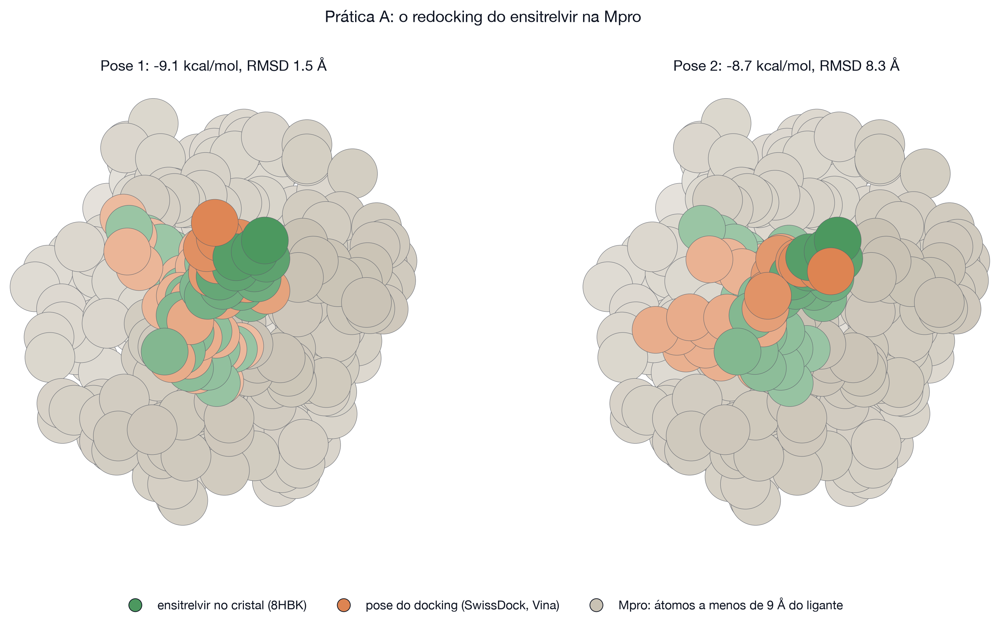

**Por que isso só existe em redocking.** Sem uma pose experimental de referência não há RMSD para calcular. Com uma molécula nova você fica só com a energia, que é o número menos confiável.

### Passo 8: ver as interações no PLIP

**8.1. Primeiro, as interações do cristal.** Abra o [PLIP](https://plip-tool.biotec.tu-dresden.de/), digite **8HBK** no campo de código PDB e envie.

**8.2.** Na saída, procure a tabela do ligante 7YY. Você deve encontrar:

| Tipo | Resíduos |
|------|----------|
| Ligação de hidrogênio | Thr26, Gly143, Ser144, Cys145, Glu166 |
| Hidrofóbica | Thr25, Met165 |
| Empilhamento π | His41 |

**Por que esses resíduos e não outros.** Cys145 e His41 são a díade catalítica da protease: o ensitrelvir ocupa justamente o ponto onde o substrato seria cortado. Gly143, Ser144 e Cys145 formam o buraco de oxiânion, que estabiliza o intermediário da reação. O fármaco funciona porque imita as interações do substrato.

**8.3. Agora, as interações da sua pose.** O PLIP precisa de um arquivo com a proteína e o ligante juntos, e o ligante marcado como `HETATM`. Há dois caminhos.

**Caminho curto.** Baixe o arquivo pronto [resultados/mpro/complexo_pose1.pdb](resultados/mpro/complexo_pose1.pdb) e envie ao PLIP pelo botão de upload.

**Caminho manual, com a sua própria pose.**

1. Abra `receptor.pdb` num editor de texto simples e apague a última linha, `END`.
2. Abra `vina_dock.pdb` e copie as linhas da primeira pose: começam depois de `MODEL 1` e terminam antes do primeiro `ENDMDL`. São 38 linhas que começam com `ATOM`.
3. Cole essas linhas no fim do `receptor.pdb`.
4. Nas linhas coladas, troque `ATOM  ` por `HETATM` no começo de cada uma. Sem isso o PLIP trata o ligante como parte da proteína e não analisa nada.
5. Acrescente uma linha `END` no fim e salve como `complexo.pdb`.
6. Envie esse arquivo ao PLIP.

**8.4.** Compare as duas listas. A pose 1 da referência repete 75% das interações do cristal: mantém as ligações de hidrogênio com Gly143, Ser144, Cys145 e Glu166, o contato hidrofóbico com Met165 e o empilhamento com His41. Perde só os contatos com Thr25 e Thr26, que ficam na borda do sítio.


**Por que contar interações, se já existe o RMSD.** O RMSD é um número só e trata todos os átomos por igual. Duas poses com RMSD parecido podem fazer contatos diferentes. A lista de interações diz **quais** contatos a pose acerta, e é disso que depende a atividade de um fármaco.

### Resultados de referência

Execução guardada em [resultados/mpro](resultados/mpro).

| Parâmetro | Valor |
|-----------|-------|
| Receptor | 8HBK, cadeia A, 2 316 átomos pesados |
| Ligante | ensitrelvir (código 7YY), 37 átomos pesados, 5 ligações rotáveis, carga 0 |
| Centro da caixa | −21,75  −11,26  2,66 |
| Tamanho da caixa | 28 × 27 × 26 Å |
| Exaustividade | 8 |
| Tempo e saída | 2 minutos, 20 poses |

| Pose | Energia (kcal/mol) | RMSD (Å) | Interações do cristal recuperadas |
|------|--------------------|----------|-----------------------------------|
| 1 | −9,13 | 1,51 | 75% |
| 2 | −8,71 | 8,32 | 25% |
| 3 | −8,64 | 6,73 | 50% |

### O que concluir desta prática

1. A pose de melhor energia é também a pose certa: neste sistema o protocolo funciona.
2. A diferença entre a pose 1 e a pose 2 é de 0,4 kcal/mol, e a pose 2 está 8 Å fora. A ordem do ranking é frágil; olhar só o primeiro número é arriscado.
3. Um redocking bem-sucedido valida o protocolo para moléculas parecidas naquele sítio. Não valida para outro alvo.

### Se o servidor estiver fora do ar

Tudo o que você precisa para os passos 6, 7 e 8 está em [resultados/mpro](resultados/mpro):

| Arquivo | Para que serve |
|---------|----------------|
| `poses.json` | energia e RMSD de cada uma das 20 poses |
| `poses_top3.sdf` | as três melhores poses em 3D, para abrir no Mol* |
| `complexo_pose1.pdb` | receptor e pose 1 juntos, pronto para o PLIP |
| `interacoes.json` | interações do cristal e das poses, já calculadas |


## Referência técnica

### Estrutura do repositório

| Caminho | Conteúdo |
|---------|----------|
| `dados/<sistema>/` | receptor limpo, ligante do cristal, ligante 3D, SMILES em pH 7,4 e caixa |
| `dados/<sistema>.zip` | os mesmos arquivos num pacote, para baixar com um clique |
| `resultados/<sistema>/` | poses, energias, RMSD e interações que eu obtive nos servidores |
| `resultados/cavidades/` | cavidades previstas pelo P2Rank e distância até cada ligante |
| `tools/` | scripts que preparam as entradas, rodam os servidores e geram as figuras |

### Scripts

| Script | O que faz |
|--------|-----------|
| `tools/prepare_inputs.py` | monta `dados/` a partir dos códigos PDB |
| `tools/swissdock_cli.py` | roda o docking no SwissDock pela API |
| `tools/analyze_poses.py` | energia e RMSD de cada pose contra o cristal |
| `tools/interactions.py` | interações do complexo com o PLIP |
| `tools/pockets.py` | cavidades no PrankWeb e comparação com os sítios reais |
| `tools/make_figures.py` | gera todas as figuras |
| `tools/export_results.py` | publica os resultados de referência e empacota as entradas |

### Erros comuns e o que fazer

| Sintoma | Causa provável | Solução |
|---------|----------------|---------|
| O servidor recusa o trabalho | fila cheia ou caixa grande demais | reduzir a caixa ou a exaustividade e repetir |
| Todas as poses ficam fora do sítio | caixa no lugar errado | conferir o centro contra o ligante do cristal |
| Energias muito melhores que o esperado | ligante grande demais ou com clash | olhar a pose, conferir a eficiência do ligante |
| O ligante sai distorcido | SMILES com estado de protonação errado | usar o estado de pH 7,4 |
| RMSD impossível de calcular | falta a pose de referência | só dá para calcular em redocking |

### Ferramentas usadas

| Ferramenta | Papel | Acesso |
|------------|-------|--------|
| SwissDock (Vina e Attracting Cavities) | docking | livre, sem conta |
| PrankWeb (P2Rank) | cavidades | livre, sem conta |
| PLIP | interações | livre, sem conta |
| Mol* | visualização | livre, sem conta |
| ClusPro | proteína-proteína e peptídeo | livre, uso não comercial, conta opcional |
| DiffDock (NVIDIA) | docking por aprendizado de máquina | exige conta e chave de API; não testado neste material |


## Referências

- Trott, O.; Olson, A. J. AutoDock Vina: improving the speed and accuracy of docking with a new scoring function, efficient optimization, and multithreading. *J. Comput. Chem.* **2010**, *31*, 455-461. https://doi.org/10.1002/jcc.21334
- Bugnon, M. *et al.* SwissDock 2024: major enhancements for small-molecule docking with Attracting Cavities and AutoDock Vina. *Nucleic Acids Res.* **2024**, *52*, W324-W332. https://doi.org/10.1093/nar/gkae300
- Jakubec, D. *et al.* PrankWeb 3: accelerated ligand-binding site predictions for experimental and modelled protein structures. *Nucleic Acids Res.* **2022**, *50*, W593-W597. https://doi.org/10.1093/nar/gkac389
- Jendele, L. *et al.* PrankWeb: a web server for ligand binding site prediction and visualization. *Nucleic Acids Res.* **2019**, *47*, W345-W349. https://doi.org/10.1093/nar/gkz424
- Le Guilloux, V.; Schmidtke, P.; Tuffery, P. Fpocket: an open source platform for ligand pocket detection. *BMC Bioinformatics* **2009**, *10*, 168. https://doi.org/10.1186/1471-2105-10-168
- Adasme, M. F. *et al.* PLIP 2021: expanding the scope of the protein-ligand interaction profiler to DNA and RNA. *Nucleic Acids Res.* **2021**, *49*, W530-W534. https://doi.org/10.1093/nar/gkab294
- Sehnal, D. *et al.* Mol* Viewer: modern web app for 3D visualization and analysis of large biomolecular structures. *Nucleic Acids Res.* **2021**, *49*, W431-W437. https://doi.org/10.1093/nar/gkab314
- Kozakov, D. *et al.* The ClusPro web server for protein-protein docking. *Nat. Protoc.* **2017**, *12*, 255-278. https://doi.org/10.1038/nprot.2016.169
- Porter, K. A. *et al.* ClusPro PeptiDock: efficient global docking of peptide recognition motifs using FFT. *Bioinformatics* **2017**, *33*, 3299-3301. https://doi.org/10.1093/bioinformatics/btx216
- Dominguez, C.; Boelens, R.; Bonvin, A. M. J. J. HADDOCK: a protein-protein docking approach based on biochemical or biophysical information. *J. Am. Chem. Soc.* **2003**, *125*, 1731-1737. https://doi.org/10.1021/ja026939x
- Kitchen, D. B.; Decornez, H.; Furr, J. R.; Bajorath, J. Docking and scoring in virtual screening for drug discovery: methods and applications. *Nat. Rev. Drug Discov.* **2004**, *3*, 935-949. https://doi.org/10.1038/nrd1549
- Fischer, E. Einfluss der Configuration auf die Wirkung der Enzyme. *Ber. Dtsch. Chem. Ges.* **1894**, *27*, 2985-2993. https://doi.org/10.1002/cber.18940270364
- Koshland, D. E. Application of a theory of enzyme specificity to protein synthesis. *Proc. Natl. Acad. Sci. USA* **1958**, *44*, 98-104. https://doi.org/10.1073/pnas.44.2.98
- Boehr, D. D.; Nussinov, R.; Wright, P. E. The role of dynamic conformational ensembles in biomolecular recognition. *Nat. Chem. Biol.* **2009**, *5*, 789-796. https://doi.org/10.1038/nchembio.232
- Unoh, Y. *et al.* Discovery of S-217622, a noncovalent oral SARS-CoV-2 3CL protease inhibitor clinical candidate for treating COVID-19. *J. Med. Chem.* **2022**, *65*, 6499-6512. https://doi.org/10.1021/acs.jmedchem.2c00117
- Gorre, M. E. *et al.* Clinical resistance to STI-571 cancer therapy caused by BCR-ABL gene mutation or amplification. *Science* **2001**, *293*, 876-880. https://doi.org/10.1126/science.1062538
- Shah, N. P. *et al.* Multiple BCR-ABL kinase domain mutations confer polyclonal resistance to the tyrosine kinase inhibitor imatinib (STI571) in chronic phase and blast crisis chronic myeloid leukemia. *Cancer Cell* **2002**, *2*, 117-125. https://doi.org/10.1016/S1535-6108(02)00096-X
- O'Hare, T. *et al.* AP24534, a pan-BCR-ABL inhibitor for chronic myeloid leukemia, potently inhibits the T315I mutant and overcomes mutation-based resistance. *Cancer Cell* **2009**, *16*, 401-412. https://doi.org/10.1016/j.ccr.2009.09.028
- Kussie, P. H. *et al.* Structure of the MDM2 oncoprotein bound to the p53 tumor suppressor transactivation domain. *Science* **1996**, *274*, 948-953. https://doi.org/10.1126/science.274.5289.948
- Vassilev, L. T. *et al.* In vivo activation of the p53 pathway by small-molecule antagonists of MDM2. *Science* **2004**, *303*, 844-848. https://doi.org/10.1126/science.1092472
- Buckle, A. M.; Schreiber, G.; Fersht, A. R. Protein-protein recognition: crystal structural analysis of a barnase-barstar complex at 2.0-Å resolution. *Biochemistry* **1994**, *33*, 8878-8889. https://doi.org/10.1021/bi00196a004
- Lin, J.-H. *et al.* Computational drug design accommodating receptor flexibility: the relaxed complex scheme. *J. Am. Chem. Soc.* **2002**, *124*, 5632-5633. https://doi.org/10.1021/ja0260162
- Amaro, R. E. *et al.* Ensemble docking in drug discovery. *Biophys. J.* **2018**, *114*, 2271-2278. https://doi.org/10.1016/j.bpj.2018.02.038
- Genheden, S.; Ryde, U. The MM/PBSA and MM/GBSA methods to estimate ligand-binding affinities. *Expert Opin. Drug Discov.* **2015**, *10*, 449-461. https://doi.org/10.1517/17460441.2015.1032936
- Wang, L. *et al.* Accurate and reliable prediction of relative ligand binding potency in prospective drug discovery by way of a modern free-energy calculation protocol and force field. *J. Am. Chem. Soc.* **2015**, *137*, 2695-2703. https://doi.org/10.1021/ja512751q
- Zimmerman, M. I. *et al.* SARS-CoV-2 simulations go exascale to predict dramatic spike opening and cryptic pockets across the proteome. *Nat. Chem.* **2021**, *13*, 651-659. https://doi.org/10.1038/s41557-021-00707-0
- Jumper, J. *et al.* Highly accurate protein structure prediction with AlphaFold. *Nature* **2021**, *596*, 583-589. https://doi.org/10.1038/s41586-021-03819-2
- Kim, S. *et al.* PubChem 2023 update. *Nucleic Acids Res.* **2022**, *51*, D1373-D1380. https://doi.org/10.1093/nar/gkac956
- Weininger, D. SMILES, a chemical language and information system. 1. Introduction to methodology and encoding rules. *J. Chem. Inf. Comput. Sci.* **1988**, *28*, 31-36. https://doi.org/10.1021/ci00057a005
- Bogan, A. A.; Thorn, K. S. Anatomy of hot spots in protein interfaces. *J. Mol. Biol.* **1998**, *280*, 1-9. https://doi.org/10.1006/jmbi.1998.1843
- Schreiber, G.; Fersht, A. R. Energetics of protein-protein interactions: analysis of the barnase-barstar interface by single mutations and double mutant cycles. *J. Mol. Biol.* **1995**, *248*, 478-486. https://doi.org/10.1016/s0022-2836(95)80064-6


## Licença

Este material está sob a licença MIT. Veja [LICENSE](LICENSE).
