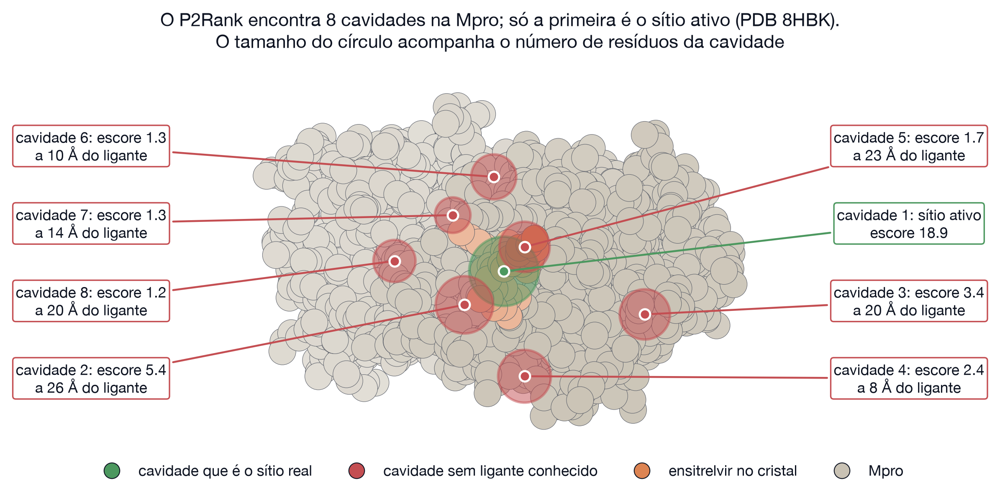
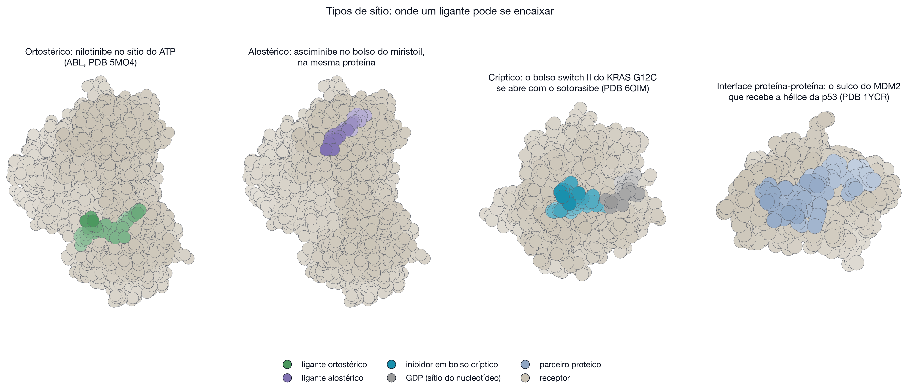
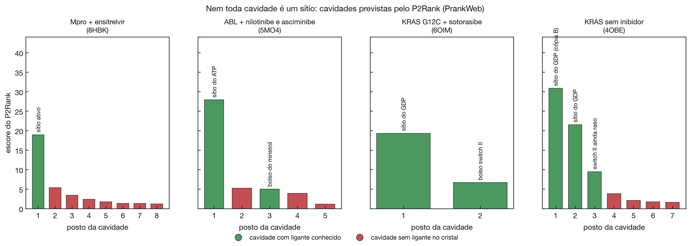

# Passo a passo: encontrar cavidades e decidir quais são sítios

Prática C. Previsão de cavidades no PrankWeb, que roda o programa P2Rank, em quatro estruturas, cada uma escolhida para responder a uma pergunta. Os valores vêm de `resultados/cavidades`.

[Voltar à aula](../README.md) · [Prática A: Mpro](mpro.md) · [Prática B: eIF4E](eif4e.md)

## O que será feito, em uma frase

Nas Práticas A e B o sítio já era conhecido, porque o cristal trazia o ligante no lugar. Aqui você parte só da proteína e pergunta **onde colocar a caixa**. O servidor devolve uma lista de cavidades ordenadas, e a sua tarefa é decidir quais podem ser sítios de verdade.

O atalho mais comum nesse ponto é supor que o maior buraco da superfície é o sítio. Os três casos a seguir mostram, com números, por que ele falha.

## Caso 1: quantas cavidades e quantos sítios?

### Passo 1.1: submeter a Mpro

**a.** Abra [prankweb.cz](https://prankweb.cz/).

**b.** Deixe selecionada a opção de **estrutura experimental**, que é a entrada por código PDB.

**c.** Digite `8HBK`, a mesma estrutura da Prática A.

**d.** Deixe a opção de **conservação** ligada.

**e.** Envie.

**Por que a conservação ajuda.** Um sítio de ligação sofre pressão evolutiva: mutações ali costumam quebrar a função, então os resíduos tendem a ser conservados entre espécies. Uma reentrância qualquer da superfície não sofre essa pressão. Conservação alta é um indício a mais de que a cavidade faz alguma coisa.

**O que esperar.** Uma fila curta e, em poucos minutos, a página de resultados.

### Passo 1.2: ler a página de resultados

A página tem três áreas: a lista de cavidades à direita, a sequência no alto e o visualizador 3D no centro.

**a.** Na lista, entenda cada coluna antes de julgar:

| Coluna | O que é | Como usar |
|--------|---------|-----------|
| Rank | posição pelo escore do P2Rank | ordem de suspeita, não de certeza |
| Score | escore bruto | compare só entre cavidades da **mesma** proteína |
| Probability | probabilidade calibrada de ser um sítio | leia como confiança, não como verdade |
| Número de resíduos | tamanho da cavidade | cavidades maiores acomodam ligantes maiores |

**b.** Clique no ícone de lupa de cada linha. O visualizador centraliza aquela cavidade.

**c.** Repare que o ligante presente na estrutura aparece em bastões. É com ele que você compara: **a cavidade cai em cima do ligante ou longe dele?**

**O que você deve encontrar na 8HBK.** Oito cavidades. A primeira, com escore 18,9, coincide com o ensitrelvir. As outras sete ficam de 8 a 26 Å dele.

Uma proteína de 300 resíduos tem, portanto, oito cavidades e um sítio. A diferença entre as duas palavras é o conteúdo desta prática.

## Caso 2: um sítio alostérico aparece na lista?

### Passo 2.1: submeter a quinase ABL

**a.** Repita o passo 1.1 com o código `5MO4`.

**O que essa estrutura tem de especial.** É a quinase ABL com **dois fármacos ligados ao mesmo tempo**: o nilotinibe no sítio do ATP, que é o sítio ortostérico, e o asciminibe no bolso do miristoil, que é alostérico.

### Passo 2.2: comparar as cavidades com os dois fármacos

**a.** Para cada uma das cinco cavidades, use a lupa e veja de qual fármaco ela está perto.

**O que você deve encontrar.**

| Cavidade | Escore | Fica a | Que sítio é |
|----------|--------|--------|-------------|
| 1 | 27,9 | 2,1 Å do nilotinibe | ortostérico, sítio do ATP |
| 2 | 5,2 | 16 Å de qualquer ligante | sem ligante conhecido |
| 3 | 5,0 | 0,9 Å do asciminibe | alostérico, bolso do miristoil |

O método acha os dois sítios reais, mas põe o alostérico em terceiro lugar, com escore cinco vezes menor que o do ortostérico. Sítios alostéricos costumam ser menores e menos pronunciados na geometria da superfície.

**Consequência clínica.** O asciminibe ocupa o lugar onde normalmente entra a cauda miristoilada da própria proteína e trava a quinase numa forma inativa (Wylie *et al.*, 2017). Como não disputa o sítio do ATP, mantém atividade em leucemias com a mutação T315I, que confere resistência ao imatinibe (Gorre *et al.*, 2001). Mudar de cavidade foi a saída para a resistência.

Descartar tudo abaixo do primeiro lugar, neste caso, significaria descartar a cavidade que deu origem a um fármaco aprovado.

## Caso 3: uma cavidade pode ainda não existir

### Passo 3.1: submeter o KRAS com e sem fármaco

**a.** Rode `6OIM`, que é o KRAS G12C com o fármaco sotorasibe ligado.

**b.** Rode `4OBE`, a mesma proteína sem fármaco nenhum.

**c.** Compare as duas listas.

**O que você deve encontrar.**

| Estrutura | A cavidade do switch II | Escore |
|-----------|--------------------------|--------|
| 6OIM, com o fármaco | aparece em 2º lugar, a 0,9 Å do sotorasibe | 6,7 |
| 4OBE, sem o fármaco | aparece em 3º lugar, rasa | 9,5, contra 21,5 do sítio do GDP |

O KRAS foi considerado não medicável por décadas, porque a superfície é lisa e não apresenta bolsão evidente ao lado do nucleotídeo. Ostrem *et al.* (2013) mostraram que inibidores covalentes da cisteína 12 abrem um bolso novo, o switch II, e desse achado veio o sotorasibe (Canon *et al.*, 2019).

O bolso já existe na estrutura sem fármaco, porém raso e mal pontuado. Cavidades que só se abrem na presença do ligante se chamam **crípticas**, e são encontradas com mais frequência pela dinâmica molecular do que pela previsão geométrica (Zimmerman *et al.*, 2021).

## Passo final: julgar uma cavidade

Antes de apontar a caixa de um docking para uma cavidade, passe por esta lista.

| Pergunta | Se a resposta for sim |
|----------|------------------------|
| A cavidade tem glicerol, PEG ou sulfato no cristal? | desconfie: pode ser artefato da cristalização |
| Ela fica entre duas cópias da proteína no cristal? | pode não existir na célula |
| Os resíduos são conservados? | indício a favor |
| Ela acomoda uma molécula do tamanho que você quer encaixar? | indício a favor |
| Existe alguma estrutura da mesma proteína com ligante ali? | é a evidência mais forte que existe |
| O escore é alto, mas nada se liga ali em nenhuma estrutura? | escore alto diz que **parece** sítio, não que seja |

O escore do P2Rank ordena suspeitas. A confirmação de um sítio vem de estrutura experimental com ligante, ensaio de atividade ou mutagênese.

## O que concluir desta prática

1. Proteínas têm muito mais cavidades do que sítios: oito contra um, na Mpro.
2. Sítios alostéricos são cavidades de verdade, só menores e pior pontuadas. Descartá-las pelo posto é perder alvos.
3. Sítios crípticos podem estar rasos ou ausentes na estrutura que você baixou.
4. Previsão de cavidade escolhe onde procurar. Ela não substitui evidência de que algo se liga ali.

## Se o servidor estiver fora do ar

Os resultados das quatro estruturas, com todas as cavidades e a distância até cada ligante do cristal, estão em [resultados/cavidades](../resultados/cavidades), um arquivo JSON por estrutura.
