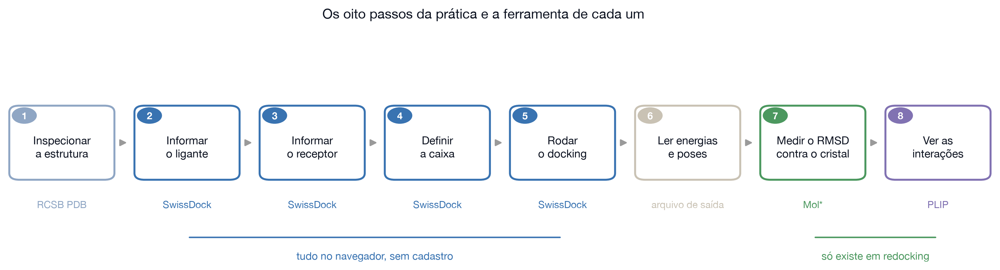
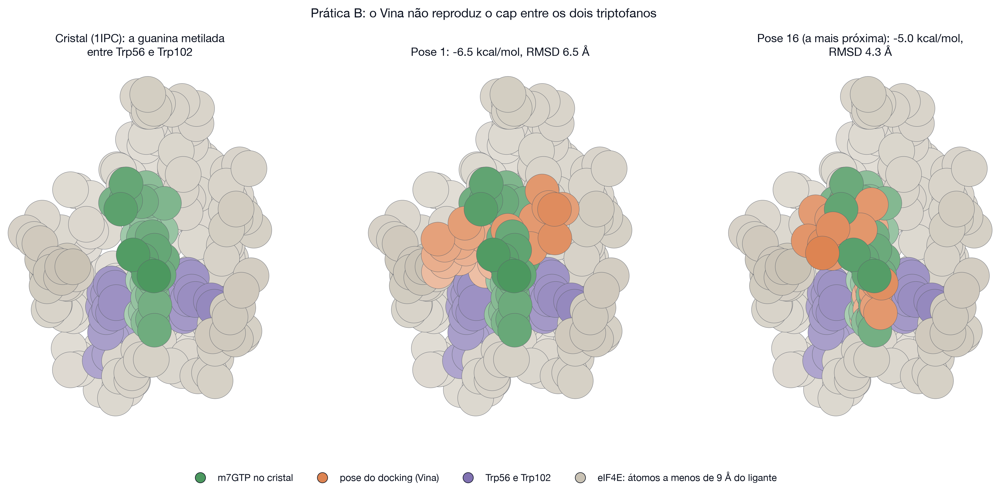
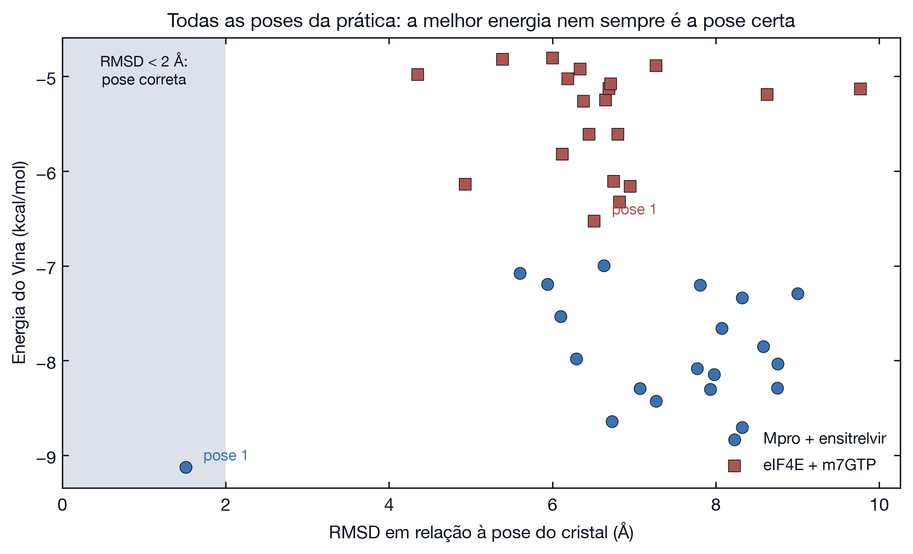

# Passo a passo: o cap do mRNA na eIF4E

Prática B. O mesmo protocolo da Prática A, aplicado a outro sistema, onde ele falha. A tarefa não é só rodar: é descobrir por que falhou. Os valores vêm das execuções em `resultados/eif4e` e `resultados/eif4e_ac`.

[Voltar à aula](../README.md) · [Prática A: Mpro](mpro.md) · [Prática C: cavidades](cavidades.md)



## O que será feito, em uma frase

A estrutura 1IPC traz a proteína eIF4E humana com o cap do mRNA encaixado. Você repete exatamente os oito passos da Prática A, trocando apenas a proteína e o ligante, e compara o resultado.

Repetir um protocolo validado em outro alvo testa até onde a validação se estende. A resposta aqui é que ela não se estende, e os números mostram em que ponto o método quebra.

## O sistema, e por que foi escolhido

Todo mRNA eucariótico começa com um cap: uma guanina metilada, com carga positiva no anel, presa ao resto da fita por três fosfatos. A eIF4E reconhece esse cap e recruta a maquinaria de tradução. É o passo limitante da síntese de proteínas.

| Lado | O que acontece |
|------|----------------|
| Saudável | o reconhecimento do cap decide quais mensagens viram proteína |
| Patológico | tumores com eIF4E ativa demais traduzem preferencialmente mensagens de proliferação e sobrevivência, o que faz da eIF4E um alvo em câncer |

Este sistema reúne três dificuldades que a Prática A não tem: carga líquida −3, dez ligações rotáveis e uma interação cátion-π, que as funções de pontuação empíricas descrevem mal por não terem termo eletrostático explícito (Trott e Olson, 2010). A maior parte dos alvos reais se parece mais com este caso do que com o anterior.

**Baixe as entradas:** [dados/eif4e.zip](../dados/eif4e.zip) e descompacte.

## Passo 1: ver no cristal o que deveria acontecer

**1.1.** Abra [rcsb.org/structure/1IPC](https://www.rcsb.org/structure/1IPC).

**1.2.** Confira em **Experimental Data Snapshot**: raios X, resolução 2,0 Å. Em **Small Molecules**, confirme o ligante **MGP**, que é o cap m7GTP.

**1.3.** Clique em **3D View** para abrir o Mol*.

**1.4.** No campo de busca do visualizador, procure os resíduos **Trp56** e **Trp102** e deixe-os visíveis em bastões, junto com o ligante.

**O que você deve ver.** A guanina metilada fica **entre os dois triptofanos**, como o recheio de um sanduíche. Os três fosfatos apontam para fora, na direção de Arg157, Lys162 e Glu103.

**Por que essa geometria é tão específica.** O anel da guanina metilada tem carga positiva, e anéis aromáticos atraem cargas positivas pela nuvem de elétrons π. É a interação cátion-π (Ma e Dougherty, 1997). O sítio da eIF4E existe para explorá-la: dois anéis, um de cada lado.

Essa geometria, o anel entre os dois triptofanos, é o gabarito contra o qual cada pose será julgada nos passos 6 e 7.

## Passo 2: informar o ligante

**2.1.** Abra [swissdock.ch](https://www.swissdock.ch/) e escolha a entrada por **SMILES**.

**2.2.** Cole a linha de `ligante.smi`:

```
C[n+]1cn([C@@H]2O[C@H](CO[P@@](=O)([O-])O[P@@](=O)([O-])OP(=O)([O-])[O-])[C@@H](O)[C@H]2O)c2nc(N)[nH]c(=O)c21
```

**2.3.** Na lista de estados de protonação, escolha o da faixa que contém **pH 7,4**.

Nesse estado o cap tem carga total **−3**, por causa dos três fosfatos, enquanto o ensitrelvir da Prática A era neutro. Essa diferença reaparece no passo 8, entre as hipóteses para a falha.

O ligante também é mais flexível: 10 ligações rotáveis, contra 5 do ensitrelvir. Cada ligação rotável multiplica o número de conformações que o programa precisa percorrer.

## Passo 3: informar o receptor

**3.1.** No campo do alvo, envie `receptor.pdb` do pacote.

É a cadeia A da 1IPC, com 1 540 átomos pesados, já sem água, sem íons e **sem o cap**. Os mesmos cuidados do passo 3 da Prática A valem aqui.

## Passo 4: definir a caixa

**4.1.** Preencha com os valores de `caixa.json`:

| Campo | Valor |
|-------|-------|
| Centro X | 54,59 |
| Centro Y | 114,72 |
| Centro Z | −7,80 |
| Tamanho X | 23 |
| Tamanho Y | 22 |
| Tamanho Z | 30 |

**4.2.** Confira no visualizador que a caixa cobre a fenda onde estava o cap, entre os dois triptofanos.

**Por que conferir a caixa com atenção aqui.** Quando um resultado sai errado, a caixa é a primeira suspeita. Confirmar agora que ela cobre o sítio permite descartar essa causa no passo 8.

## Passo 5: rodar com o Vina

**5.1.** Deixe a exaustividade em **8**.

**5.2.** Clique em **Docking with AutoDock Vina**.

**Por que manter tudo igual à Prática A.** Mudar uma variável de cada vez é o que permite atribuir a causa. Se o procedimento é idêntico e o resultado muda, a diferença está no sistema, não no protocolo.

**O que esperar.** Cerca de 2 minutos e 20 poses.

## Passo 6: ler o resultado

**6.1.** Baixe e descompacte o pacote, e abra `vina_dock.pdbqt` como no passo 6 da Prática A.

**O que você deve obter.**

| Pose | Energia (kcal/mol) | RMSD (Å) |
|------|--------------------|----------|
| 1 | −6,53 | 6,51 |
| 2 | −6,33 | 6,82 |
| 4 | −6,14 | 4,93 |
| 16 | −4,98 | 4,35 |

**Nenhuma das 20 poses fica abaixo de 3 Å.** E a melhor pose em RMSD, a 16, está entre as piores em energia: se você escolhesse pelo critério normal, ficaria com a pose 1.

## Passo 7: olhar a pose, não só o número

**7.1.** Abra `ligante_cristal.sdf` e `vina_dock.pdb` no [Mol*](https://molstar.org/viewer/), como no passo 7 da Prática A.

**7.2.** Deixe visíveis também Trp56 e Trp102.

**O que você deve ver.** A pose 1 mantém o empilhamento com **Trp102**, mas perde o **Trp56**. O programa achou metade da interação: encostou numa das fatias do sanduíche e não entrou entre as duas.



**Por que olhar a pose e não parar no RMSD.** O número 6,51 Å diz que a pose está errada; a imagem mostra de que maneira, e é disso que saem as hipóteses do passo seguinte.

## Passo 8: investigar a causa

Um resultado ruim não encerra o exercício. Liste as causas possíveis, diga o que cada uma preveria e teste as que estiverem ao seu alcance.

| Hipótese | O que ela prevê | Como testar | O que aconteceu |
|----------|------------------|-------------|------------------|
| Ligante flexível demais (10 ligações rotáveis) | com menos fosfatos, melhora | repetir com o m7GMP | continuou errando: 4,95 Å |
| Pontuação fraca em cátion-π e eletrostática | outro método melhora | repetir com Attracting Cavities | melhorou, passo 9 |
| Carga −3 e custo alto de dessolvatação | ligantes neutros vão melhor | comparar com o ensitrelvir | consistente: o neutro acerta |
| Receptor rígido, sítio que fecha sobre o cap | precisaria do receptor em movimento | exige dinâmica molecular | fora do alcance desta aula |

**8.1. Para testar a primeira hipótese,** repita os passos 2 a 6 trocando apenas a SMILES por esta, do m7GMP, que tem um fosfato em vez de três:

```
C[n+]1cn(c2c1C(=O)NC(=N2)N)[C@H]3[C@@H]([C@@H]([C@H](O3)COP(=O)([O-])[O-])O)O
```

**O que esperar.** Continua errando: a melhor pose fica a 4,95 Å considerando os átomos em comum.

**O que esse teste elimina.** Se a flexibilidade fosse a causa principal, remover dois fosfatos teria resolvido, porque o m7GMP tem 6 ligações rotáveis contra 10 do m7GTP. Não resolveu, o que desloca a explicação para a função de pontuação e para a carga.

## Passo 9: trocar o método, no mesmo servidor

**9.1.** Repita os passos 2 a 4 exatamente como antes.

**9.2.** No fim, clique em **Docking with Attracting Cavities** em vez do Vina.

**9.3.** Aparecem parâmetros que só existem nesse método. Use os da referência: exaustividade de amostragem **90**, prioridade de cavidade **70** e **2** condições iniciais aleatórias.

**O que esperar.** Cerca de **15 minutos**, contra 2 do Vina, e 106 poses agrupadas em 50 famílias.

| Medida | Vina | Attracting Cavities |
|--------|------|---------------------|
| Melhor pose do ranking | 6,51 Å | 4,60 Å |
| Menor RMSD entre todas as poses | 4,35 Å | 2,41 Å |
| Poses abaixo de 3 Å | nenhuma | 6% |
| Tempo | 2 min | 15 min |

Separando a molécula em duas partes, o resultado fica mais claro: numa das poses de topo o anel da guanina metilada cai a 0,85 Å da posição do cristal, e são os três fosfatos que ficam fora do lugar. O método acerta a parte que o sítio reconhece e erra a cauda carregada.

O Attracting Cavities gera poses corretas, mas as classifica em posição intermediária. Sem o cristal para comparar, o único critério disponível seria a energia, e ela apontaria para outra pose. Trocar de método melhorou a amostragem do espaço de busca, não a função que ordena os resultados.

## O gráfico que resume as duas práticas

Pondo energia contra RMSD para todas as poses de A e B, a diferença fica evidente: na Mpro a melhor energia é a pose certa; na eIF4E, nenhuma pose chega perto, e a menos errada está entre as piores em energia.



## O que concluir desta prática

1. Um protocolo validado num sistema não está validado em outro. O redocking vale para o alvo em que foi feito.
2. Ligantes muito carregados e muito flexíveis são o caso difícil das funções de pontuação rápidas.
3. Quando o resultado é ruim, troque uma variável de cada vez e registre o que cada troca previa.
4. Sem referência experimental, não há como validar uma pose por dentro. É por isso que o passo seguinte natural é a dinâmica molecular, que testa se a pose sobrevive em água.

## Se o servidor estiver fora do ar

| Pasta | Conteúdo |
|-------|----------|
| [resultados/eif4e](../resultados/eif4e) | as 20 poses do Vina, energias, RMSD, interações e o complexo pronto para o PLIP |
| [resultados/eif4e_ac](../resultados/eif4e_ac) | as 106 poses do Attracting Cavities |
| [resultados/eif4e_m7gmp](../resultados/eif4e_m7gmp) | o teste com o m7GMP |
